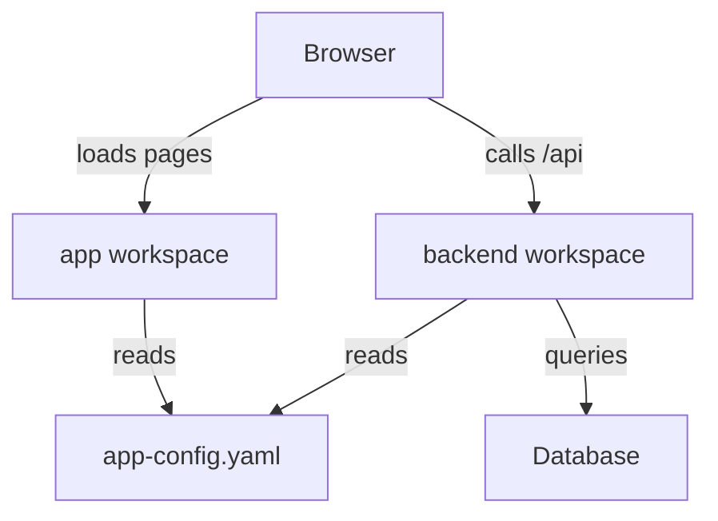

# Workspaces And The Parts Of A Project

A new developer clones a Backstage repository and wants the portal on the screen. Before running any command, the developer needs a map of what the repository contains and which part does which job. This part gives that map: the workspaces, the root package, and the two processes that make a running portal.

A Backstage project is an application assembled from packages, not a single static website. A package is a folder with a `package.json` file that names it and lists its scripts and dependencies. A workspace setup lets one repository hold many packages and install them together. The root `package.json` lists the package folders in its `workspaces` field, for example `packages/*`.

<!-- astrona:playground:renew -->

Open a shell in the playground with `astrona ssh ats-069-playground-010-01` and look at the example project. It has the same shape as a generated Backstage project, but it is small and its scripts are simplified:

```sh
cd /opt/portal
ls
yarn workspaces list
```

The `ls` command shows the root files: `package.json`, `app-config.yaml`, `app-config.production.yaml` and the `packages` folder. The `yarn workspaces list` command prints one line for the root and one for each package under `packages/`. Yarn, the package manager, finds them by reading the `workspaces` field.

## The root package

The root package is private. Nothing publishes it. Its job is to describe the workspace arrangement and to offer common scripts. A script is a named command stored in the `scripts` field. Yarn runs it with `yarn <name>`.

```sh
cat package.json
```

The scripts `start`, `build:backend` and `build:all` live here. A generated Backstage project defines scripts like these in its root package, but the names belong to that project. A script name is not a promise that every release uses the same one. Older projects used `yarn dev` where current ones use `yarn start`. The `package.json` is the only reliable source for what a name runs.

## The app workspace and the backend workspace

The `app` workspace produces the browser interface. In a real project it holds React code that the browser downloads and runs. It contains the page layout and the frontend part of each plugin. It never holds server credentials, because every user who loads the page can read what the browser receives.

The `backend` workspace is a Node.js process. It serves the APIs that the browser calls. It runs the catalog processing and talks to databases and to outside systems. It holds the credentials those systems need. The browser reaches it over the network, usually on a different port than the app.



The diagram shows two separate paths from the browser. One path loads the interface, and the other calls the server APIs. The two workspaces share the configuration files, but they do not share a process.

## Other packages

A real project can hold more packages than these two. A plugin package adds a feature. A shared package can hold types or helper code that both the app and the backend import. Packages inside the workspace refer to each other by name, and Yarn links them, so a change in a shared package is visible to its users without publishing anything.

The example project has only the two main packages. That is enough to show the rule that matters for the rest of the module: each workspace has its own `package.json`, its own scripts and its own dependencies.

```sh
cat packages/backend/package.json
cat packages/app/package.json
```

Both files have a `start` script and a `build` script. The `start` script runs the package from its source files. The `build` script writes a `dist` folder. These two scripts are the two paths of the module: development and production.

## Which process does the work

Readers often mix up the root script and the processes it starts. The root script `start` does not serve anything. It starts two child processes, one for `app` and one for `backend`, and then waits. The process that answers a request on port 3000 is the app server. The process that answers on port 7007 is the backend. The root script only coordinates them.

This matters when something breaks. If the page loads but a card shows a request error, the app process works and the backend or its route is the problem. If the backend runs but the page is blank, the app process is the place to look. A root script that starts both can show healthy output from one while the other has already exited.

## Where a command runs from

Yarn runs a package script with the package folder as the working directory. A command such as `yarn workspace backend start` therefore resolves relative paths from `packages/backend`, not from the root. A path that works when you type it in the root can fail inside a script. For this reason the backend start script in a project refers to the configuration file with a path that climbs back to the root.

```sh
yarn workspace backend start
```

In the playground this command starts the backend, which prints the port it listens on. Press Ctrl+C to stop it. The command name has the form `yarn workspace <package name> <script>`, where the package name comes from the `name` field of the package, not from its folder.

## What the project needs before it runs

Several prerequisites must be true before any script runs. A supported Node.js release must be installed. The package manager chosen by the repository must be available. The dependencies of every workspace must be installed. The configuration must contain the keys that the installed features need. Native dependencies can also need operating-system libraries or build tools.

Matching these prerequisites matters more than copying a command from another project. A project that works on one machine because of a dependency installed outside the repository fails on a clean checkout, because that dependency was never declared in a `package.json`.

The playground shows one prerequisite directly:

```sh
node --version
yarn --version
```

The two commands print the installed versions. Backstage documents the current Active LTS releases of Node.js and a specific Yarn version for generated projects, so a version check is the first step when a clone fails to start.

## Where this leaves the developer

The project is a root package plus an `app` workspace and a `backend` workspace. Each has its own scripts, and each runs as its own process. A script runs from its own package folder. The next question is what happens when those processes start: which files they read and in what order the checks happen.

## Common pitfalls

> [!WARNING]
> Do not treat a script name as a fixed contract. Read the `scripts` field before you run a command from another project. Do not assume a relative path in a script is relative to the root: Yarn runs it from the package folder. A running frontend does not show that the backend started.
