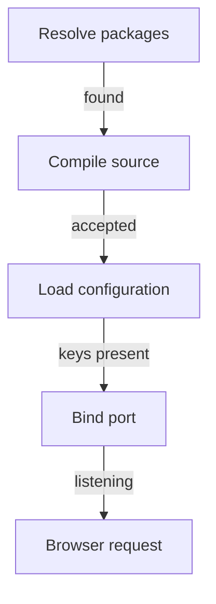

# Development Servers And Configuration

A developer changes a page and wants to see the result in seconds. A development server exists for that purpose. It runs the source files directly, it restarts or reloads when they change, and it reads the configuration every time it starts. This part follows a start from the first command to the first response, and shows where a start can fail.

A development server optimizes feedback. In a real Backstage project the frontend development server rebuilds the browser assets when a source file changes. The backend process hosts the plugin routes and reads the server configuration. A root script can start both, but starting both does not merge them. A browser request still crosses the network from the page to the backend.

<!-- astrona:playground:renew -->

Start only the backend in the playground. The command stays in the foreground, so use a second terminal (`astrona ssh ats-069-playground-010-01` again) for the requests:

```sh
cd /opt/portal
yarn start:backend
```

The process prints the port it listens on. In the second terminal, request the health check and the example route:

```sh
curl http://localhost:7007/healthcheck
curl http://localhost:7007/api/deployment-status
```

The first response is a small JSON object with `status` set to `ok` and an `environment` value. The second names the `portal-backend` service. Both come from the backend process, which received the requests on port 7007. Stop the backend with Ctrl+C in the first terminal.

## Startup is a sequence of contracts

A start succeeds only when several conditions hold in order. Package resolution must first find every imported module. Compilation must accept the source. The configuration must provide the keys that the installed features need. The process must bind its address and initialize its dependencies, such as a database. Finally the browser must reach the right server.

A later symptom does not erase an earlier failed contract. If the process cannot read its configuration, it never reaches the point where it binds a port, so a request to that port fails with a refused connection. The refused connection is the symptom. The missing configuration is the cause.



The diagram shows the order of the contracts. A failure at one step stops every step after it, so the first failing step is the one to repair.

## Configuration files and merging

Backstage reads configuration from YAML files. The base file is `app-config.yaml`. Additional files can override it. Each `--config` option on the command line names one file, and later files win over earlier ones where they define the same key. A project can therefore keep shared values in the base file and put environment values in a separate file. Local overrides such as `app-config.local.yaml` follow the same rule.

```sh
cat app-config.yaml
cat app-config.production.yaml
```

The base file defines `app.baseUrl`, `backend.baseUrl` and `backend.listen.port`. The production file defines one key, `environment`. When the backend starts with both files, it reads the base file first and the production file second, so `environment` takes its value from the second file.

The package script passes the file name. Look at how the backend script names its configuration:

```sh
grep '"start"' packages/backend/package.json
```

The path in the script is `../../app-config.yaml`. It climbs two folders from `packages/backend` to the root, because Yarn runs the script from the package folder.

## A missing configuration value

The backend checks that its required keys exist before it listens. Remove one and watch the check work. Open `app-config.yaml` in an editor such as `nano`, delete the two lines `listen:` and `port: 7007` under `backend`, and save the file. Then start the backend again:

```sh
yarn start:backend
```

The process prints `Error: Missing required config value at 'backend.listen.port'` and exits. The message names the key, which is the evidence needed to repair the problem. Put the two lines back and start again to confirm that the backend listens.

This failure happens after compilation and before the port is bound. A project that compiles cleanly can still fail here. In a real Backstage project, each plugin and module declares the configuration it reads, and a missing required value stops that part of the backend at startup.

## Browser-visible and server-only values

The app runs in the user's browser. Anything the browser receives, any user can read. Backstage therefore separates configuration by visibility. Values that the frontend needs are marked as visible to the frontend in the configuration schema of the package that defines them. Values without that mark stay on the server.

Development convenience must not blur this line. A token placed in a block that is delivered to the browser is public the moment the page loads. Server-only values such as credentials for an outside system belong to the backend configuration path. Local development is not a security boundary either: a process on a developer machine can reach real services if it holds real credentials, so local files should use credentials with limited authority and isolated data.

The example app serves the part of the configuration that the browser may see:

```sh
yarn start
```

The `start` script starts the app and the backend as two processes. In a second terminal, run:

```sh
curl http://localhost:3000/config.json
```

The response holds the `app` block and the backend base URL. It does not hold the `backend` block as a whole. Stop both processes with Ctrl+C in the first terminal.

## When the page works and the feature fails

Take a portal with a catalog page and a deployment-status card. The page layout can render when the card's backend route is unavailable. The card then reports a request failure. The useful evidence is the requested route, the response status and the matching server log line. Rebuilding a logo file does not touch that boundary.

The opposite case also happens. A syntax error in the component of the card stops the card from rendering before any request is sent. In that case the backend log shows nothing at all, because the browser never called it. The two cases look alike on the screen and differ in where the evidence is.

## Ports and origins

The backend listens on its own port, 7007 in a generated project, and the frontend development server listens on 3000. The browser treats two ports as two origins, so the backend must allow the frontend origin when the page calls it. The `app.baseUrl` and `backend.baseUrl` values in the configuration tell each side where the other one lives. If `app.baseUrl` does not match the address in the browser, requests can fail even though both processes run.

In the example project the app server takes its port from `app.baseUrl`. Change that value to `http://localhost:3001`, start the app with `yarn workspace app start`, and request `http://localhost:3001/`. Then change it back. The experiment shows that one configuration value controls where a process listens.

## What a green start proves

A started process proves that its own contracts held: its modules resolved, its configuration was complete, and its port was free. It does not prove that the external systems it needs accept its credentials. Those checks happen when a feature first calls them. A repaired start error therefore does not show that the whole system is healthy. It shows that the next boundary can now be tested.

## Common pitfalls

> [!WARNING]
> A running frontend does not prove that backend plugins initialized. A refused connection often means the process exited earlier because of configuration, not that the network is broken. Do not place a secret in a block that the browser receives. Read the first error a process prints before you change anything else.
