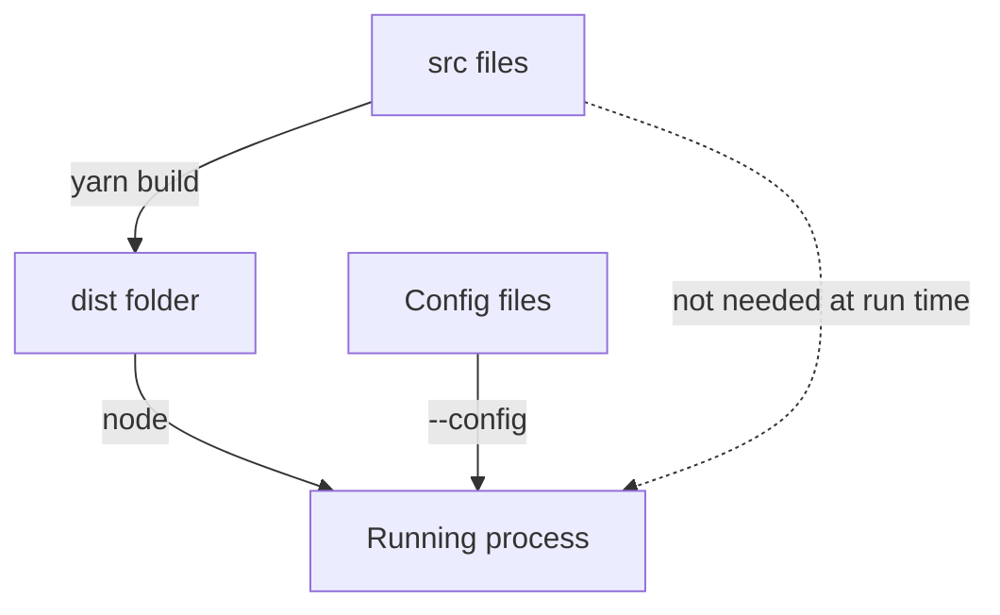

# Production Builds And Artifacts

A development server proves that the source runs on a developer machine. A deployment needs something different: files that a server can run without the source tree, the package manager cache or the development tools. This part explains what a production build produces, how it differs from the development path, and how to check that an artifact is complete.

A production build has a different purpose from a development start. It transforms source and dependencies into artifacts suitable for the chosen runtime. The backend build produces files that Node.js can load. The frontend build produces browser assets: static files and a configuration that the page reads. A deployment can serve the assets through the backend or through a separate web server that someone configures on purpose.

## Build scripts and their names

In a generated Backstage project the root package defines scripts for building. Typical names are `build:backend`, which builds the backend package, and `build:all`, which builds every package. The Backstage command-line tool also has a repository-level build, `backstage-cli repo build`. These names describe responsibilities. The exact scripts belong to the package definitions of the project, and a name alone is not a contract for every release.

<!-- astrona:playground:renew -->

In the playground, read how the example project defines its build scripts:

```sh
cd /opt/portal
grep '"build' package.json packages/backend/package.json packages/app/package.json
```

The root `build:backend` script runs the `build` script of the backend workspace. The root `build:all` script runs the `build` script of every workspace. Each workspace `build` script runs a small Node.js program that copies the `src` folder to a `dist` folder.

## Running the build

Build only the backend and list what the build produced:

```sh
yarn build:backend
ls packages/backend/dist
```

The `dist` folder is new. It holds a copy of the files the backend needs. In a real project the build also compiles TypeScript to JavaScript and bundles the code with its dependencies, which is why the output is not a plain copy of the source. The example copies because it has no TypeScript. The rule is the same: `dist` holds what the runtime loads.

Now build everything and compare:

```sh
yarn build:all
ls packages/app/dist
```

The app `dist` folder has the browser files and a `config.json`. The build wrote that file from the configuration files named in the app `build` script. It contains the `app` block and the backend base URL.

## A build is a snapshot

The build reads the configuration when it runs and stores the result. After that, editing `app-config.yaml` does not change the built `config.json`. A new build is needed. This differs from the development server, which reads the files each time it starts.

The difference explains a common surprise. A value changed in the base configuration shows up at once in development and does not appear in a built artifact until the artifact is built again. Server-side values often behave differently: the backend can read its configuration files when it starts, so a deployment can supply them at run time. Which values are fixed at build time and which are read at start depends on the package, so check before you assume.

## Running the artifact alone

An artifact is only proven by running it without the development path. Run the built backend directly with Node.js, using both configuration files:

```sh
node packages/backend/dist/index.js --config app-config.yaml --config app-config.production.yaml
```

In a second terminal request the health check:

```sh
curl http://localhost:7007/healthcheck
```

The response now has `environment` set to `production`. The value comes from `app-config.production.yaml`, the second file, which overrides the default of the backend. Stop the process with Ctrl+C.

The command did not use Yarn and did not touch `src`. It used only the files in `dist` and the configuration. That is the property a deployment needs.



The diagram shows that the running process needs the build output and the configuration files, and does not need the source folder.

## Proving the artifact is complete

A build can succeed and still leave out a file. A development server hides that mistake, because it reads the source folder, where every file is present. The artifact fails only when it runs alone.

Test it directly. Move the source folder away and run the artifact:

```sh
mv packages/backend/src /tmp/backend-src
node packages/backend/dist/index.js --config app-config.yaml --config app-config.production.yaml
```

Press Ctrl+C after the process prints that it listens, then move the folder back:

```sh
mv /tmp/backend-src packages/backend/src
```

If the build had copied only the entry file, the process would stop with an error naming a module it could not find. That error names the file the build forgot.

## Prerequisites of a production start

The runtime machine needs the same kind of prerequisites as a development machine, with fewer tools. It needs a supported Node.js release. It needs the dependencies that the bundle does not include, and native dependencies need matching operating-system libraries. It needs configuration files that define the required keys, and it needs the secrets that the backend reads at run time.

A new integration shows why the last point matters. Suppose a catalog integration needs an authentication setting. The build succeeds, because the build does not check it. The process rejects the missing setting when it starts. That sequence points at configuration as the blocker. It does not show that the integration's permissions on the outside system will work. That is a later check, and treating the two as one claims too much.

## Development and production side by side

The development path reads source files, restarts quickly, and may run both processes from one script. The production path runs the built files, runs in a defined environment, and is started by whatever supervises the process, such as a container runtime. Differences are expected. The risk is a difference that nobody wrote down, for example an environment variable that exists on the developer machine only.

A short checklist covers most of it: build from a clean checkout, run the artifact without the source, give it the configuration of the target environment, and request one route that touches each major part. The first failure tells which contract is missing.

## Common pitfalls

> [!WARNING]
> A working development server does not show that the production artifact has its runtime files. Run the built output alone before you call a build good. A built configuration is a snapshot: rebuild after you change a value that the browser reads. Do not copy a build command from another project without reading the scripts of this one.
