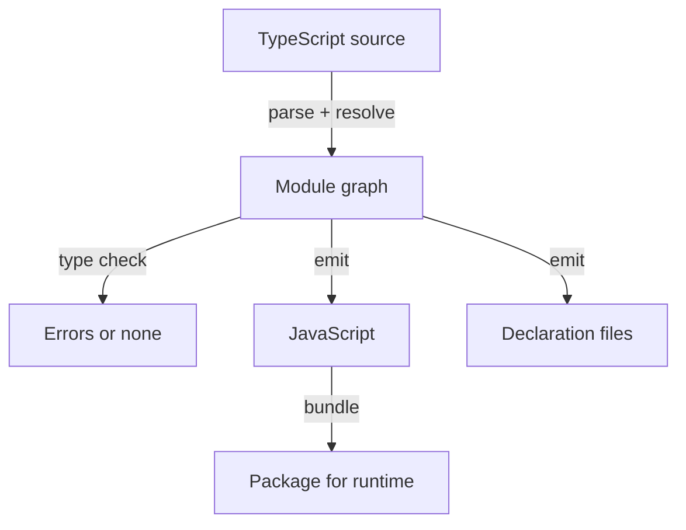

# Checking, Emitting And The Scope Of tsconfig.json

A team opens a pull request for the `deploy-backend` plugin of the `portal` repository. The pipeline prints a green result for the type check, and a reviewer merges the change. A week later the plugin fails in the running backend because a function reads a property that does not exist. The check was green because the file with the mistake was never part of the check. This part explains what the TypeScript compiler does, which operations are separate from each other, and how `tsconfig.json` decides what is checked.

TypeScript is a language that adds static types to JavaScript. The compiler, `tsc`, is the program that reads TypeScript source files and applies the rules of that language. A static type is a description of a value, such as "a string" or "an object with an `id` and a `status`", that the compiler checks before the program runs. Browsers and Node.js cannot read types. They run JavaScript only, so the types must be removed before the code runs.

## The operations behind the word compile

People say "compile" for several different operations. Each one has its own input, its own output and its own way of failing. Keeping them apart is the skill that this part teaches.

- **Parsing and module resolution.** The compiler reads each file and works out which other file each `import` points to. A failure here means a module cannot be found.
- **Type checking.** The compiler compares how values are used with how they are declared. A failure here is a type error, for example calling `toUpperCase()` on a value that may be `undefined`.
- **Emit.** The compiler writes output files: JavaScript with the types removed, and optionally declaration files (`.d.ts`) that contain only the types.
- **Bundling.** A separate tool joins many modules into the files that a runtime loads. `tsc` does not bundle.

A Backstage repository does not use one tool for all four operations. The `tsc` command is run on the repository root to check types. The Backstage command-line tool, `backstage-cli`, builds each package with its own build system and does not check types during that build. The Backstage documentation says that building and type checking are kept separate. A green build therefore does not show that the types are correct, and a green type check does not show that the package builds.



The diagram shows that checking and emitting both start from the same module graph, and that the compiler can do the first without the second.

## Checking without writing files

The option `noEmit` tells `tsc` to check and write nothing. Backstage repositories use this idea for the root check: the goal is a result, not files. The exit code of `tsc` is the result. It is `0` when the compiler found no errors and not `0` when it found at least one.

Open the playground and go to the workspace. The workspace has three packages and a configuration file that checks all of them in one run.

<!-- astrona:playground:renew -->

Run the check and print the exit code:

```sh
cd /opt/portal
tsc -p tsconfig.check.json
echo "exit code: $?"
```

The compiler prints nothing when it finds no errors, so the exit code is the only evidence of success. The option `-p` (short for `--project`) selects the configuration file. Without it, `tsc` looks for `tsconfig.json` in the current folder. In this workspace that file is a solution file that lists projects to build, and it checks no source files by itself.

## What tsconfig.json decides

A `tsconfig.json` file is the configuration of one compiler project. A project is the set of files that the compiler treats as one unit, together with the options that apply to them. Three groups of fields matter most.

The fields `include`, `exclude` and `files` choose the root files of the project. A root file is a file that the compiler starts from. The compiler also reads every file that a root file imports, but it only reports errors for the files in the project and reads other files for their types. A pattern such as `packages/*/src` matches the `src` folder of every package under `packages`. A file that matches no pattern and is not imported by a matched file is not checked at all.

The `compilerOptions` field sets the language rules and the output. The option `strict` turns on a group of checks, among them `strictNullChecks`, which makes `undefined` a separate type that must be handled. The option `target` sets the JavaScript version of the output. The option `module` sets the module format of the output, for example `commonjs`. The option `types` lists which global type packages the compiler loads; the playground sets it to an empty list, so no global types are loaded automatically.

The field `extends` points to another configuration file whose options are copied first. The file that extends it can then override single options. Backstage repositories use this pattern: the root file extends a shared base from the Backstage command-line package and adds its own `include` and output folder. The playground uses the same idea with `tsconfig.base.json`.

## Seeing which files are in scope

The question "which files did this check cover?" has a direct answer. The option `--listFilesOnly` makes `tsc` print every file that would be part of the project and then stop. The option `--showConfig` prints the configuration after `extends` has been resolved.

Print the file list and count only the files of the workspace:

```sh
tsc -p tsconfig.check.json --listFilesOnly | grep '^/opt/portal' | grep -v node_modules
```

The result lists the three `index.ts` files of the workspace. The compiler also reads library declaration files for the language itself, which the second `grep` filters out of this view. If a plugin folder is missing from the list, then a type error in that folder cannot fail this check.

Print the merged options:

```sh
tsc -p tsconfig.check.json --showConfig
```

The output shows the options from `tsconfig.base.json` and from `tsconfig.check.json` together. The file `tsconfig.check.json` sets `composite` to `false` and `noEmit` to `true`, and the output shows that these values replaced the ones from the base.

## A scope mistake, step by step

The next steps reproduce the opening story. They change a config file, so the instructions follow the usual three steps.

Save this as `scope-demo.json` in `/opt/portal`. It checks only the `app` package:

```json
{
  "extends": "./tsconfig.base.json",
  "compilerOptions": { "composite": false, "noEmit": true },
  "include": ["packages/*/src"]
}
```

Add an error to the backend plugin: edit `plugins/deploy-backend/src/index.ts` and replace the body of `describeOwner` with `return record.owner.toUpperCase();`. Then check with both files:

```sh
tsc -p scope-demo.json; echo "scope-demo exit code: $?"
tsc -p tsconfig.check.json; echo "full check exit code: $?"
```

The first command ends with exit code `0`, because the backend plugin is not a root file of that project and the `app` package does not import it. The second command reports an error in the backend plugin and ends with a non-zero exit code. Both commands ran the same compiler on the same source. The only difference is the `include` list. Restore the original body of `describeOwner` before you continue.

## Strictness is part of the contract

The option `strict` is a setting in the configuration, not a property of the source. Turning it off removes errors without changing any code, so a green result under a weaker setting is a weaker claim. When you read a check result, read the options as well: the scope, `strict`, and whether declaration files from dependencies are checked (`skipLibCheck`).

The option `skipLibCheck` skips type checking of declaration files (`.d.ts`). It makes the check faster and hides errors inside the declaration files of dependencies. It does not skip checking of your own source. Backstage repositories commonly set it for the everyday check, and a separate full check without it can run in a pipeline.

## Where the checked result stops

A type check compares code with declarations. It does not run the code, it does not call the network, and it does not read the configuration files of the application. It cannot say whether the backend starts, whether a route answers, or whether the data from a service matches its declared shape. Those questions need other evidence, such as how data crosses the line between declared types and real values.

This part separated four operations behind the word compile and showed that `tsconfig.json` decides which files the check covers. The open question is what happens to types when the check passes but the value at runtime is not what the type says.

## Common pitfalls

> [!WARNING]
> A green `tsc` result covers only the files in the project. If an `include` pattern misses a folder, errors in that folder never appear. Print the file list with `--listFilesOnly` when a result looks too good. Do not turn off `strict` to remove an error: the option changes what the claim means, not what the code does. Do not read a clean type check as a successful build, because the build tool runs separately.
