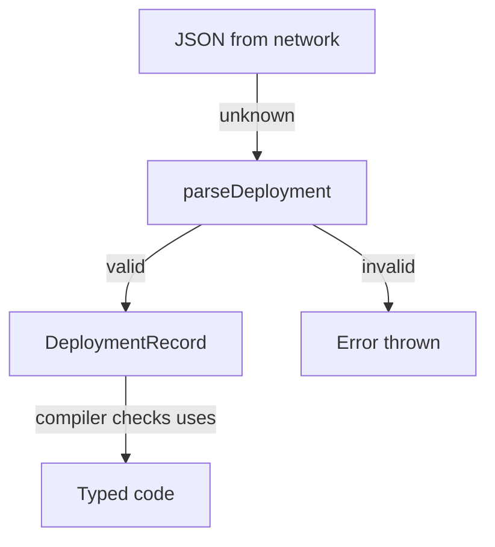

# Types, Optional Values And Runtime Boundaries

The `deploy-backend` plugin of the `portal` repository shows a deployment record in a catalog card. The plugin type says that a record has an `id`, a `status` and an optional `owner`. One day the card crashes for a record that has no owner, and a second day it shows the status `done`, a value that the plugin type does not allow. Both problems are about the gap between what a type declares and what a value is at runtime. This part shows what the compiler can promise, what it cannot, and how to close the gap in the right place.

A type exists only while the compiler runs. When `tsc` or another build tool emits JavaScript, it removes every type annotation, every `interface` and every `type` alias. The running program contains no trace of them. A declared type is therefore a promise that the compiler checks inside your source code. Nothing enforces the promise at the moment a value arrives from outside the program.

## Optional properties and the undefined value

An optional property is declared with a question mark: `owner?: string`. Its type is `string | undefined`, which means the value is either a string or `undefined`. With the option `strict` turned on, the compiler tracks that `undefined` is possible and refuses any use that assumes a string.

Open the workspace and look at the shared types.

<!-- astrona:playground:renew -->

```sh
cd /opt/portal
cat plugins/deploy-common/src/index.ts
cat plugins/deploy-backend/src/index.ts
```

The type `DeploymentRecord` in `deploy-common` has the optional `owner`. The function `describeOwner` in `deploy-backend` first compares `record.owner` with `undefined` and only then calls `toUpperCase()`. That comparison is called narrowing: inside the branch where the comparison is false, the compiler knows the value is a `string`.

Break the function on purpose. Replace the body of `describeOwner` with this line, then run the check:

```ts
return record.owner.toUpperCase();
```

```sh
tsc -p tsconfig.check.json; echo "exit code: $?"
```

The compiler reports an error on `record.owner` and says that the object is possibly `undefined`. The exit code is not `0`. The compiler found a real crash path before the code ran: a record without an owner would make `toUpperCase` throw a `TypeError` in the backend process.

## Three ways to silence the error

There are three common repairs, and only one of them removes the crash path.

The first repair handles the absence. The code decides what a missing owner means, for example the text `unassigned`. The source contract stays strict, and the user sees a sensible result. This is the repair that the original function uses.

The second repair is a type assertion: `record.owner as string`. An assertion tells the compiler to trust the programmer. It emits no code. At runtime nothing changes, so the record without an owner still crashes the function. The error is gone and the crash path is still there.

The third repair is the non-null assertion operator, written as an exclamation mark after the value, for example `record.owner!.toUpperCase()`. It has the same effect as the previous one: the compiler stops reporting, and the runtime behaviour is unchanged. Disabling `strict` for the whole project removes the error in the same way for every file, which is the broadest and least visible version of the same mistake.

Restore the original body of `describeOwner` before you continue.

## Data from outside is not checked by types

Some values do not come from your source code. A JSON body from a network request, a value read from a file, the result of `JSON.parse` and a response from another service all arrive as data whose shape the compiler cannot know. The function `JSON.parse` returns the type `any`, which the compiler treats as "anything is allowed". An `any` value can be assigned to a typed variable without any check.

Look at what the `app` package does with a request body:

```sh
cat packages/app/src/index.ts
```

The function `renderRow` does not assign the result of `JSON.parse` to a `DeploymentRecord`. It passes the value to `parseDeployment`, a function in `deploy-common` that receives `unknown`. The type `unknown` is the safe counterpart of `any`: the compiler allows a value of that type to be stored, but it requires a check before the value is used. `parseDeployment` checks that the input is an object, that `id` is a string, that `status` is one of the two allowed words and that `owner`, if present, is a string.

Run the parser against good and bad input. The check needs the compiled JavaScript, so build the shared package first:

```sh
tsc --build plugins/deploy-common
node -e "const c=require('/opt/portal/plugins/deploy-common/dist'); console.log(c.parseDeployment({id:'bridge-1',status:'running'}))"
node -e "const c=require('/opt/portal/plugins/deploy-common/dist'); c.parseDeployment({id:'bridge-1',status:'done'})"
```

The first command prints the record, with `owner` set to `undefined`. The second command throws the error `status must be running or failed`. This error comes from the runtime check in the function. The compiler did not stop the input, because the compiler never sees the input: it exists only when the program runs.

## Which component catches which mistake

The two checks protect different boundaries, and they fail at different times.

- **The compiler** checks calls inside your source. It catches a function that reads a property that the declared type does not have, a call with the wrong argument type and a missing handling of `undefined`. It runs before the program starts, on your machine or in a pipeline.
- **The runtime check** is code that you write, such as `parseDeployment`. It catches data that violates the declaration. It runs in the backend process, every time data arrives.

A type assertion on external data, for example `JSON.parse(body) as DeploymentRecord`, skips both. The compiler accepts the claim, and no runtime code verifies it. The result looks typed everywhere afterwards, which makes later errors harder to trace to their source. Put the check at the edge, where untrusted data enters, and let the typed code behind it rely on the result.



The diagram shows that the runtime check turns `unknown` data into a typed record, and that the compiler only checks what happens after that point.

## Type errors and runtime errors in a Backstage project

A Backstage backend plugin receives data from the catalog database, from other plugins over HTTP and from external systems. The frontend receives responses from the backend. The compiler checks the code of each package against the shared types. A runtime error such as a `401` response from a service, a missing configuration key or a database that is down never appears as a type error. The sequence for diagnosis is therefore: if the compiler reports an error, read the declaration and the caller. If the compiler is silent and the program fails, read the process log and the data that arrived.

A third class of failure is a successful check on code that is correct in isolation but wrong in context, for example a plugin that expects a field that a newer version of another service no longer sends. Types cannot show this by themselves. A runtime check at the boundary shows it as a clear error message instead of a crash in unrelated code.

## What this part leaves open

The compiler checks types inside one project, and a runtime check guards the data that enters it. A Backstage repository has many packages that import each other. The remaining question is how the compiler and the build tools know in which order to process packages, and what the other packages see when one package is built.

## Common pitfalls

> [!WARNING]
> A type assertion (`as`) and the non-null operator (`!`) silence the compiler and add no runtime code, so a crash path stays. Treat `JSON.parse` as `unknown` data and validate it where it enters. Do not read a type error in a plugin as a network problem, and do not read a working network call as proof that its response matches the declared type.
