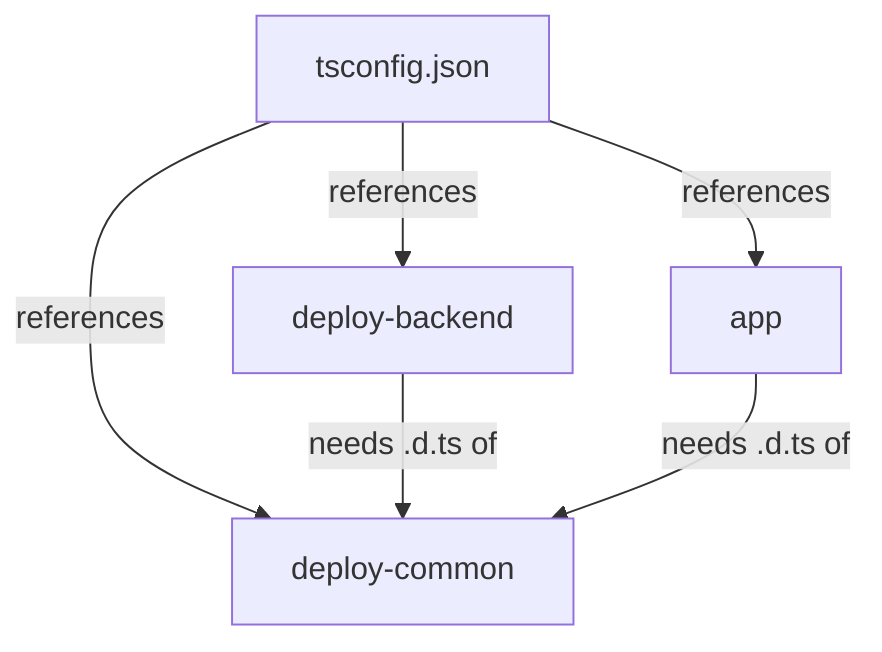

# Workspace Builds, Project References And Declaration Files

The `portal` repository has an `app` package, a `deploy-backend` plugin and a shared `deploy-common` package. A developer changes a type in `deploy-common` and runs the type check of `deploy-backend`. On the developer's machine it passes. On a clean pipeline machine it fails, because the declaration files of `deploy-common` do not exist there yet. This part explains why packages in a workspace depend on each other's output, how project references give the compiler a build order, and why stale or missing output causes results that differ between machines.

A workspace is one repository that holds several packages, each with its own `package.json`. The root `package.json` lists the package folders in its `workspaces` field, for example `packages/*` and `plugins/*`. A package manager such as Yarn links these packages to each other so one package can import another by name. The compiler needs a second kind of information: when package A imports package B, what does the compiler read for B?

## Two ways to read another package

The compiler can read the source of the other package, or it can read the output of a previous build of that package.

Reading the source is simple. The compiler type checks the imported files together with the importing project. The cost is that a project then checks every imported file again, and that the project boundary is blurred: errors in the other package can appear in the importing project. In the playground, the file `tsconfig.base.json` has a `paths` entry that maps the name `@portal/deploy-common` to the source folder of that package. The option `paths` tells the compiler where to look for a module name. It affects only the compiler. The emitted JavaScript keeps the import name unchanged, and `tsc` does not rewrite it, so a runtime or a bundler has to resolve the name through the workspace links.

Reading the output is the approach of project references. A reference tells the compiler "this project depends on that project; use its declaration files". A declaration file is a file with the extension `.d.ts` that contains only types: function signatures, interfaces and exported type aliases, without function bodies. The compiler can type check a project against these files without parsing the dependency's source again.

## Composite projects and references

A project that others reference must set the option `composite` to `true`. This option makes the project promise three things. The project must list all its files with `include` or `files`. It must emit declaration files. It must keep a build information file, with the extension `.tsbuildinfo`, that records what the last build read and wrote. The compiler uses that file to skip work when nothing changed.

A project that depends on another project lists it in the field `references`, with the path to the other project's folder. Look at the three configuration files that do this in the workspace.

<!-- astrona:playground:renew -->

```sh
cd /opt/portal
cat tsconfig.json
cat plugins/deploy-backend/tsconfig.json
cat plugins/deploy-common/tsconfig.json
```

The root `tsconfig.json` has `"files": []`, so it contains no source files. It exists only to list the three projects in `references`. A file shaped like this is called a solution file. The `deploy-backend` project references `deploy-common`, and the `app` project does too. The `deploy-common` project has no references, because it depends on no other project.

## Build mode and build order

The command `tsc --build` (short form `tsc -b`) starts build mode. In build mode, `tsc` reads the references, orders the projects so that every project is built after the projects it references, and then builds each one. For each project it first decides whether the output is up to date. If an input file is newer than the output, the project is built again. If an earlier project in the order fails, the projects that depend on it are skipped.



The diagram shows that `deploy-common` has to be built first, because the other two projects read its declaration files.

Run the build and list the output of the shared package:

```sh
tsc --build
ls plugins/deploy-common/dist
```

The folder `dist` of each project now holds the JavaScript file, the declaration file and the `.tsbuildinfo` file for that project. The option `outDir` in each project configuration chose this folder, and `rootDir` told the compiler that the source starts in `src`, so `src/index.ts` becomes `dist/index.js`.

Run the same command again without any change:

```sh
tsc --build
```

The second run is fast, because the build information shows that no input changed. Edit one file in `deploy-common` and run it a third time. The compiler builds `deploy-common` and then the two projects that reference it. Their output has to be checked again against the changed declarations.

## Why references matter when they are missing

Remove the line that references `deploy-common` from `plugins/deploy-backend/tsconfig.json`, clean the output and build again:

```sh
tsc --build --clean
tsc --build
```

The option `--clean` deletes the output of the listed projects. The build now fails for `deploy-backend`. The file `plugins/deploy-common/src/index.ts` is imported by the backend plugin, but it belongs to a different composite project, and the backend project did not declare that dependency. A missing reference therefore breaks a clean build. The same build can appear to work on a machine that still has old output, which is why the opening story passed on one computer and failed on another. Restore the reference before you continue.

## Declaration output and the public contract

A project that other packages use publishes its types through declaration files. The compiler writes one `.d.ts` file for each source file, and it includes only the exported parts of the code. A consumer sees the function `parseDeployment` and the type `DeploymentRecord`, because they are exported. A consumer does not see a function that is not exported. A change to an exported signature changes the declaration file, and every project that references this one has to be checked again.

In a Backstage repository the same idea applies at the package level. The root check writes its incremental output to a folder named `dist-types` in the repository root, and the build of a package with type definitions uses that output as its input. The Backstage documentation therefore says to run the type check before building packages that publish type definitions. A package that is built without current declaration files can publish types that do not match its code.

The field `exports` in a `package.json` lists the entry points that other packages may import. An import of a deep path, such as `@portal/deploy-common/src/internal`, bypasses that public contract. It can work for months and fail when the owner moves the file. Correct the import to the exported entry point. Do not weaken the compiler settings to hide the error.

## Generated and stale output

Output folders are generated files. The source of truth is the TypeScript source and the configuration. Editing a file in `dist` fixes nothing, because the next build overwrites it. An old `dist` folder left from an earlier branch can make a type check pass against declarations that no longer match the source. A clean build removes the output first. In Backstage repositories a script that cleans the repository and then runs a full check without incremental output is used for this purpose in pipelines.

The build information file is also an output. If it is stale or damaged, deleting it forces a full build. If a pipeline caches `dist` folders, the cache key has to include the source and the configuration, or the pipeline reads old declarations.

## Transpilation is a separate step

The build mode of `tsc` produces JavaScript and declarations, and it checks types. The Backstage command-line tool builds each package in isolation and does not check types. It transpiles the TypeScript source, which means it converts it to JavaScript one file at a time, without needing the types of other files. A type error therefore does not stop that build, and only the root check reports it. A pipeline that runs only the build can ship a type error. A pipeline that runs only the check can miss a packaging problem such as a missing file in the package.

## What the module has now shown

The compiler checks the files in scope. The runtime needs checks at its data boundaries. A workspace build needs a dependency order, and project references provide it together with declaration files. The question that remains is how to tell, from a failure, which of these three layers owns the problem.

## Common pitfalls

> [!WARNING]
> A build that passes with old output does not show that a clean build passes. Run `tsc --build --clean` and build again before you trust a result. Do not edit files in `dist`: the next build replaces them. A `paths` mapping affects only the compiler, not the emitted JavaScript, and a missing `references` entry breaks a clean build on a machine without old output.
