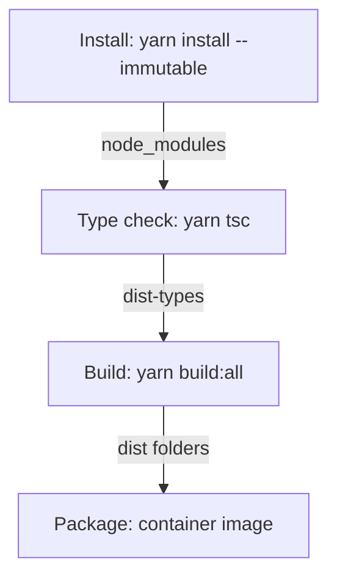

# Building The Whole Repository

A pipeline does not build one package. It has to build the libraries, the plugins, the app and the backend from a clean checkout, in an order that works, and fail clearly when one step breaks. The root `package.json` offers scripts for this. This part explains what the root scripts run, what a clean pipeline looks like from checkout to artifacts, and how to find the failing step.

The root scripts of a repository from the Backstage template include these. The script `tsc` runs the type check for the whole repository. The script `build:backend` runs the build of the backend workspace only. The script `build:all` runs `backstage-cli repo build --all`. The command `backstage-cli repo build` is the repository-level build: it reads the role of every package and builds them. Without `--all` it leaves out the bundled app and backend packages and builds the packages that are published, such as libraries and plugins. The option `--all` includes them.

## The stand-in scripts

The playground root has a `build:all` script that runs the `build` script of every workspace. The npm option `--workspaces` runs a script in each workspace listed in the root `package.json`, and `--if-present` skips a workspace that has no such script.

<!-- astrona:playground:renew -->

Run it from nothing and check the result:

```sh
cd /opt/portal
rm -rf packages/*/dist plugins/*/dist
npm run build:all
ls -d packages/*/dist plugins/*/dist
```

The last command lists four `dist` folders. The stand-in builds the packages one after another in the order of the workspace list. A real `backstage-cli repo build` builds many packages in parallel and reads each role, so its order is not the order of the list.

## A pipeline from checkout to artifacts

A clean pipeline for a Backstage repository runs the same steps every time. Each step needs the output of the one before it.



The diagram shows the order of the steps and what passes between them. The install step creates `node_modules` from the lockfile and fails if the lockfile and the manifests disagree. The type check writes declarations to `dist-types`. The build reads them for libraries and writes `dist` in every package. The last step packages the backend and the app into artifacts.

The steps run from a clean checkout, so a step cannot rely on something left behind on a developer machine. This is the point of the pipeline: stale output on one machine, such as an old `dist` folder, stops hiding problems. Reproduce it locally by deleting all `dist` and `dist-types` folders and running the steps in order.

## Finding the failing step

When the pipeline fails, name the step first, and then run that step alone. A failure in install points at the lockfile or the registry. A failure in the type check points at a type error or a missing declaration. A failure in the build points at resolution, syntax or a role. Run the script that the pipeline runs and not a hand-typed command, so that the flags are the same.

Try this with the playground. Add a syntax error in `packages/app/src/index.ts`, for example a missing closing brace, and run the build:

```sh
npm run build:all
echo "exit code: $?"
```

The build still finishes the transpile step for files it can parse and reports the syntax problem, and the exit code is not `0`. The parse failure is the build's kind of failure: the file could not be converted. Restore the file afterwards. A type error would not have failed the build at all, so the two failures need two different commands to find.

## What a clean build proves

A successful pipeline run proves that the repository builds from its sources and its lockfile on a clean machine, that its types are consistent and that the output files exist. It does not prove that the backend starts with the production configuration or that the app talks to it. Those need a run of the artifact, with the configuration of its target environment.

This part showed the root scripts, the order of a pipeline and how to place a failure at the step that owns it. The module's practice applies these ideas to a workspace in which the roles, the root script and the published files are wrong.

## Common pitfalls

> [!WARNING]
> Do not build one package and assume the repository builds: a root script that reaches only some packages hides the rest. Do not run the library build before the type check has written `dist-types`. Do not debug a pipeline with a command that differs from its script, because flags change the result. Remove old `dist` folders before trusting a local build.
