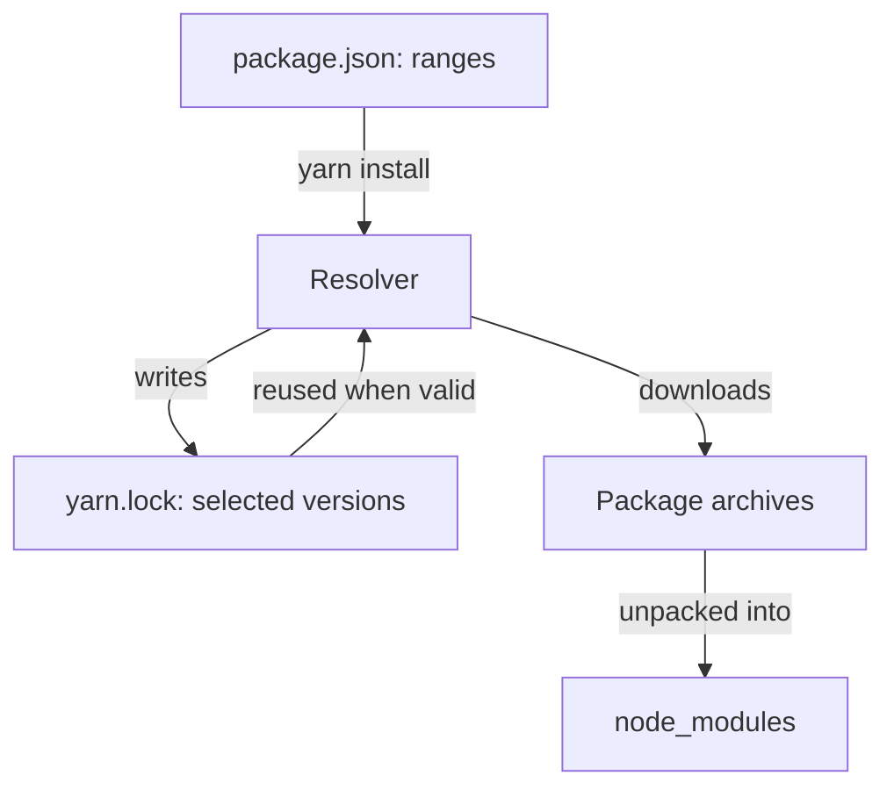

# Manifests, Version Ranges And The Lockfile

A Backstage project is a repository of many JavaScript packages. Each package needs other packages to run: the framework, plugins and small utility libraries. Something has to decide which exact versions of all those packages end up on disk. If that decision changes between two machines, the same source code can behave differently on each. This part names the files that make the decision and shows which file is written by whom.

## What the manifest declares

A package manifest is the `package.json` file at the root of a package. It is a JSON file that declares the package name, its version, its scripts and its dependencies. Each dependency is a pair: the name of another package and a version range that the package accepts. The manifest is written by people, or by commands such as `yarn add` that edit it for them.

Open the root manifest of the example project in the playground. It lives in `/opt/portal`:

<!-- astrona:playground:renew -->
```sh
cd /opt/portal
cat package.json
```

The file marks the project as `private`, which stops it from being published by accident. It lists `workspaces`, the folders that contain the packages of the project. It has a `packageManager` field that names the tool and its version, here `yarn@4.4.1`. It also has a `scripts` object with entries such as `start` and `tsc`. A script name is only a label for a command line. A different project can define the same name and run something else.

The two packages `app` and `backend` have their own manifests. Read the one for the backend:

```sh
cat packages/backend/package.json
```

The `dependencies` object of this file lists the packages the backend needs at run time. A second object, `devDependencies`, lists packages needed only to build or test. A package manager installs both in a development checkout. A production install can skip the second group, so a package that the running code imports must not sit there.

## Version ranges

A version range states which releases a package accepts. Package versions follow semantic versioning, which writes a version as three numbers, `major.minor.patch`. A patch release is meant to fix bugs. A minor release adds features and keeps old behavior. A major release is allowed to break old behavior. These are promises made by the package authors, and the package manager cannot check them.

The caret range `^7.6.0` accepts every release from `7.6.0` up to, but not including, `8.0.0`. The tilde range `~7.6.0` accepts `7.6.0` up to, but not including, `7.7.0`. A plain version such as `7.6.0` accepts that one release. The range `^0.4.1` is special: for a `0.x` version the caret only accepts patch releases, so it stops before `0.5.0`.

Look at the range the shared package uses for the `semver` package, a small library that parses and compares version numbers:

```sh
grep -n semver packages/shared/package.json
```

The range is a caret range. On the day you run this, many releases can satisfy it. The manifest alone therefore does not say which release you get. Two developers who install a week apart from the same manifest can receive two different releases if a new one was published in between.

## What the lockfile records

A lockfile removes that uncertainty. The lockfile is a file written by the package manager. It records, for every package in the graph, the exact version that was selected, where it came from and a checksum of its content. Yarn writes `yarn.lock` and npm writes `package-lock.json`. The graph includes transitive dependencies, which are the dependencies of your dependencies.

Read the start of the Yarn lockfile of the example project:

```sh
head -30 yarn.lock
```

The first block is a `__metadata` entry with the lockfile format version. Every later block starts with a quoted descriptor such as `"semver@npm:^7.6.0"`, the package name and the range that some manifest asked for. Under it, the field `version` holds the selected release, `resolution` holds the exact package and source, and `checksum` holds a hash of the downloaded archive. The workspaces of the project appear too, with the version `0.0.0-use.local`, because they are resolved from the local folders and not from a registry.

One lockfile block can serve several ranges. If two packages ask for `semver@^7.6.0` and `semver@^7.5.0`, the descriptors can share one block and one selected release. This is how a project avoids installing many copies of the same library.



The diagram shows that the resolver reads both the manifest and the lockfile, writes new choices back into the lockfile and then unpacks the archives into `node_modules`.

## How an install uses both files

When you run `yarn install`, the package manager first compares the manifests with the lockfile. If every range in every manifest already has a matching lockfile entry, it keeps those entries and does not ask the registry for newer releases. For a range with no entry, it asks the registry which releases exist, selects one that satisfies the range and writes it to the lockfile. Then it downloads the archives, checks their checksums and unpacks them.

You can see the result on disk. List the packages that Yarn placed at the root of the project:

```sh
ls node_modules | head
ls -l node_modules/@internal
```

Packages of the workspace appear as symbolic links to their folders. This lets a change in a workspace package show up for every package that depends on it, without a new install. Packages from the registry are real folders.

Ask which version of `semver` the lockfile selected, and compare it with what the installed folder reports:

```sh
grep -A3 '^"semver@' yarn.lock
node -p "require('semver/package.json').version"
```

The two answers must match. The lockfile is the source for the installed version, and the manifest only limits the choices.

## npm uses the same idea with other file names

The npm client follows the same model with different files and commands. Its lockfile is `package-lock.json`, and it records a nested tree of packages with `version`, `resolved` and `integrity` fields. The playground has a second, small project in `/opt/npm-demo` for a comparison:

```sh
cd /opt/npm-demo
cat package.json
head -25 package-lock.json
```

The `integrity` field is a hash of the archive, like the Yarn `checksum`. If the downloaded archive does not match, the install stops. This check detects a package whose content changed after the lockfile was written. It does not decide whether the package is safe to run.

A project must use one package manager. If both `yarn.lock` and `package-lock.json` exist, the two tools can select different versions, and a developer cannot tell which file the build uses. The project records its choice in the `packageManager` field and in the files it commits. A move from one tool to another is a deliberate change that gets its own review.

## Who may change which file

The roles are simple to state. People change manifests, either by editing them or by running `yarn add` and `yarn remove`. The package manager changes the lockfile as a result of an install. Nobody edits the lockfile by hand, because a hand edit can break its checksums and its internal consistency.

Both files are committed to version control. A pull request that changes a range shows two diffs: a one-line change in a manifest and a larger change in the lockfile. A reviewer reads the manifest change for the intent and the lockfile change for its size and surprises. A lockfile change with no manifest change means that some other install selected new versions, and the reason needs an explanation.

You now know which file states intent, which file states the result and how an install reads both. The open question is where in a repository with several packages each declaration belongs, and what goes wrong when a package depends on something it never declared.

## Common pitfalls

> [!WARNING]
> Do not edit `yarn.lock` or `package-lock.json` by hand. Do not commit a manifest change without the matching lockfile change. Do not keep two lockfiles from two package managers in one project. A range such as `^7.6.0` does not name a release: only the lockfile does.
