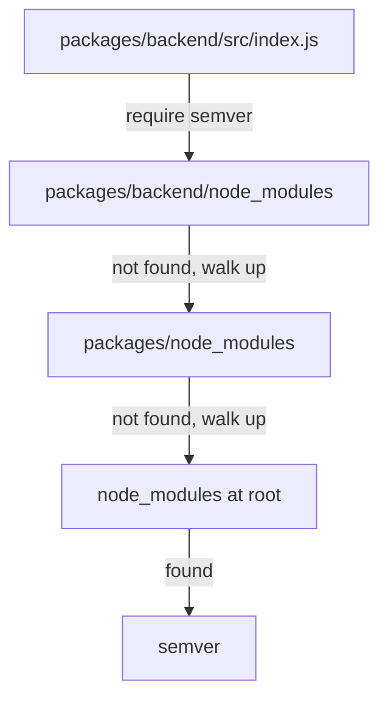

# Workspaces And The Dependency Boundary

A Backstage repository holds an `app` package for the browser, a `backend` package for the server and often several plugin packages. All of them are installed together. That convenience creates a trap: a package can use code that another package installed, without saying so. This part explains how workspaces share one install, where the packages end up on disk, and why every package must still declare what it imports.

## What a workspace is

A workspace is a package inside a repository that the package manager treats as part of one project. The root manifest lists the folders in its `workspaces` field, for example `packages/*`. The package manager reads every manifest that matches, builds one dependency graph for all of them and writes one lockfile at the root. One `yarn install` at the root installs everything.

List the workspaces that Yarn found in the example project:

<!-- astrona:playground:renew -->
```sh
cd /opt/portal
yarn workspaces list
```

The command prints one line per workspace with its folder. The root itself is listed as `.`. Names such as `app` and `backend` come from the `name` field of each manifest, and Yarn uses that name to find the package when another manifest depends on it.

The shared package of the example project is named `@internal/shared`. The part before the slash is a scope, a prefix that groups packages under one owner. Scopes do not change how installation works. They avoid name clashes with packages from the public registry.

## How packages depend on each other

A package depends on another workspace package the same way it depends on a registry package: with an entry in `dependencies`. The version range then has to match the version of the workspace, or it can use the `workspace:` protocol. With the range `workspace:^`, Yarn always links the local package and refuses to look for it in the registry. The range `^1.0.0` also resolves to the local package while the local version is `1.0.0`, because Yarn prefers a matching workspace.

That second case has a failure mode. Suppose the shared package is at version `1.0.0` and a manifest asks for `^2.0.0`. No workspace satisfies the range, so Yarn asks the public registry for a package with that name. The registry has no such package, or has an unrelated one, and the install fails or installs the wrong code. Read the range in a manifest as a statement about the package you want, and check that the local version satisfies it.

Print what the app package declares:

```sh
cat packages/app/package.json
yarn workspace app why @internal/shared
```

The `why` command answers which package asks for `@internal/shared` and which range it uses. It is the first tool to use when a package appears in the graph and nobody remembers why.

## Where installed packages go

The default layout that Backstage projects use is called `node-modules`. It is set in `.yarnrc.yml` with `nodeLinker: node-modules`. The package manager installs packages into a `node_modules` folder at the repository root and shares them among all workspaces. When two workspaces need the same version of a package, the project keeps one copy. This is called hoisting.

Node.js finds a package by walking up from the importing file: it looks in `node_modules` next to the file, then in the parent folder, and so on up to the root. A file in `packages/backend` that imports `semver` is satisfied by `/opt/portal/node_modules/semver`, because the walk reaches the root. The walk does not ask whether `backend` declared `semver`. It only asks whether a folder with that name exists.



The diagram shows that Node.js reaches the root folder and finds `semver` there, whatever the manifest of the backend says.

## The hidden dependency

This is the source of the hidden dependency. Package `backend` imports `semver`, and package `shared` declares `semver`. After one install, `semver` sits at the root, and the backend code runs. Nobody notices that the backend manifest has no entry for it. The manifest says the backend needs nothing from the registry, and the code says otherwise.

Check this in the playground. Find which manifests mention `semver`, and which source files import it:

```sh
grep -rn '"semver"' packages/*/package.json
grep -rn "require('semver')" packages/*/src
```

The two lists must name the same packages. If a package imports a library that its own manifest does not declare, it has a hidden dependency.

The hidden dependency breaks in four situations. First, someone removes `semver` from the package that did declare it, and the backend fails at start. Second, a package manager that does not hoist, such as Yarn with the Plug'n'Play linker or pnpm, refuses the import at once. Third, a production packaging step copies only the declared dependencies of the backend into an image, and the image fails at start. Fourth, a tool that checks declared dependencies reports the missing entry.

The fix is a declaration in the package that imports the code. Declare it with the command that edits the manifest and updates the lockfile together:

```sh
yarn workspace backend add semver
```

The `add` command writes the dependency into `packages/backend/package.json` with a caret range and refreshes `yarn.lock`. If the package is already in the lockfile with a compatible range, Yarn reuses that entry and no new download is needed.

## Declaring the right kind of dependency

A package puts a dependency in one of three groups, and the group has a meaning. `dependencies` lists what the code needs when it runs. `devDependencies` lists what is only needed to build, lint or test, such as the TypeScript compiler or a test runner. `peerDependencies` lists what the package expects its user to provide, for example a plugin that expects the host application to supply React.

The group matters in production. A host-build container image installs only the production dependencies of the backend. A library that the server imports but that sits in `devDependencies` is missing from that image. The development server still works, because a development checkout installs both groups. The failure appears only in the packaged result.

Use `yarn workspace backend add -D <package>` for a development-only tool. Use no flag for a run-time dependency. Peer dependencies are written by hand, because they state a requirement and do not install anything for the package that lists them.

## A declaration is a boundary

A workspace is a unit that other people can reason about. The backend manifest should list everything the backend needs, and the app manifest everything the app needs. With that rule, a reviewer can see from one manifest which packages a change can affect. A tool can build the backend alone with exactly its declared packages. A package can be moved to another repository without a search for what it quietly used.

The rule also shows in changes. A plugin that gains a new import needs a manifest change in the same pull request. A review that finds a new import with no manifest change has found a hidden dependency before it reaches production.

You now know how workspaces share one install, how hoisting makes undeclared imports work by accident, and how to declare a dependency where it is used. What is left is how to install only what the lockfile says, how to force a version when a library must be replaced, and how to read an install that fails.

## Common pitfalls

> [!WARNING]
> A package that imports a library must declare it in its own manifest. A library that happens to sit in the root `node_modules` is not a declaration. A range that no local workspace satisfies makes the package manager ask the public registry for a package of the same name. Do not put run-time imports in `devDependencies`.
