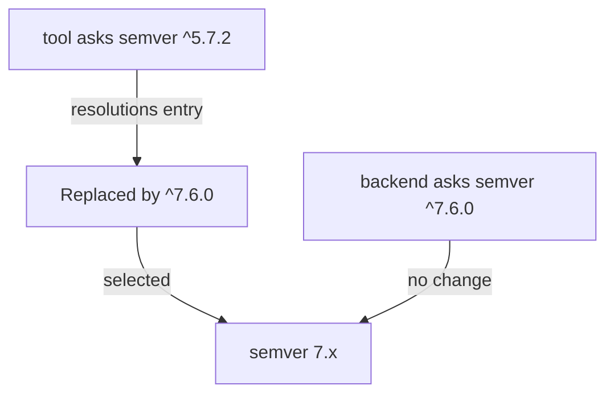

# Reproducible Installs, Resolutions And Failures

A developer who runs `yarn install` on a laptop accepts that the install may change the lockfile. A build server that verifies a reviewed commit must not accept that. This part explains the install commands that refuse to change the lockfile, how to force one version of a transitive dependency, and how to sort an install failure by its cause.

## Two kinds of install

An install has one of two purposes. The first purpose is to change the dependency graph on purpose: add a package, move a range, refresh the lockfile. The second purpose is to reproduce a graph that is already committed. The commands differ because the second purpose must fail when the files disagree, instead of repairing them.

For Yarn 4, the second command is `yarn install --immutable`. It runs the resolution step but treats a lockfile change as an error. If every manifest range has a matching lockfile entry, the install continues. If any manifest range has no entry, or the lockfile has entries that no manifest asks for, Yarn stops with an error that says the lockfile would have been modified.

Run it in the playground project, where the files agree:

<!-- astrona:playground:renew -->
```sh
cd /opt/portal
yarn install --immutable
echo "exit code: $?"
```

The exit code is the signal that automation reads. Zero means the install matched the lockfile. Any other value means the build must stop.

For npm, the matching command is `npm ci`. It deletes any existing `node_modules` folder, installs exactly the tree that `package-lock.json` records and fails when `package.json` and the lockfile do not agree. The command `npm install` has the other role: it can update the lockfile. The two are not spelled the same way in both tools, and an older Yarn release uses other flags, so read the version that the project pins.

Try the npm form in the comparison project:

```sh
cd /opt/npm-demo
npm ci
echo "exit code: $?"
```

## Making the failure visible

The value of an immutable install appears when the files disagree. Add a range to a manifest without updating the lockfile and run the immutable install again. The playground project is yours to change, so edit the manifest of the app package with a range for a package that the lockfile does not know:

```sh
cd /opt/portal
node -e "const f='packages/app/package.json';const p=require('./'+f);p.dependencies=p.dependencies||{};p.dependencies['semver']='^7.5.0';require('fs').writeFileSync(f,JSON.stringify(p,null,2)+'\n')"
yarn install --immutable
echo "exit code: $?"
```

The command fails with a non-zero exit code, because the lockfile has no entry for the `app` workspace asking for `semver`. Yarn does not repair the file. Now run the plain install, which is allowed to change the lockfile, and run the immutable install again:

```sh
yarn install
yarn install --immutable
echo "exit code: $?"
```

The plain install updates `yarn.lock`. The second command passes, because the files now agree. In a real repository, the updated `yarn.lock` goes into the same commit as the manifest change. A build server that runs the immutable install on that commit passes. A build server that runs it on a commit with only the manifest change fails, and that failure is the review feedback that was needed.

## Forcing a version with resolutions

The lockfile selects versions that satisfy every range. Sometimes the selection is not acceptable. A library that your project does not control can ask for an old release of a package with a known security fix in a later release. You cannot edit that library, and its range blocks the fix.

The Yarn `resolutions` field in the root manifest overrides what the resolver selects. An entry has a descriptor on the left and the replacement on the right. The entry `"semver@^5.7.2": "^7.6.0"` says that every request for `semver@^5.7.2`, from any package, is answered with the range `^7.6.0`. npm has a similar field named `overrides`. The root manifest holds the field, and it only works at the root of a workspace project.



The diagram shows that both requests end at one selected release, which leaves one copy of the package in the lockfile.

A resolution is a risk that you accept. The library that asked for the old range was tested with the old release. The new release can behave differently. Before you add an entry, check that the API that the library uses still exists, and run the checks of the affected workspaces. Keep the entry in the root manifest only while it is needed, and write the reason in the commit message.

Find out how many releases of a package the lockfile holds:

```sh
cd /opt/portal
grep -c '^"semver@' yarn.lock
yarn why semver
```

The first command counts descriptor blocks for `semver`. The second lists every package that causes `semver` to be installed and the release it gets. One block can contain several descriptors, so read the `version:` lines too when you need the number of releases.

## Sorting install failures by cause

Not every failure is a lockfile problem. The first error line of the output usually names its category. Sorting the failure first avoids retrying the same command.

A Node.js version mismatch appears when a package declares in its `engines` field that it needs a release range that your Node.js is outside. Check `node --version` and compare it with the project's supported range before you change anything else.

A registry failure shows as a network error, a timeout or a not-found error for a package name. A not-found error for a package whose name looks like a local workspace usually means that its range matched no workspace, so the resolver asked the public registry. Check the range and the local version.

An authentication failure shows as an unauthorized or forbidden response for a package in a private scope. The fix is the approved credential path for that registry, set in the user or project registry configuration, and never a token written into a committed manifest.

A native build failure shows compiler output for a package that contains compiled code, such as one that wraps a C library. It means the machine lacks a compiler, the Python version a build tool needs or a system library header. The cause lies in the platform and the Node.js release, not in the lockfile.

A checksum or integrity failure means that the downloaded archive does not match the recorded hash. Do not delete the hash to make the error go away. Find out whether the registry content changed, whether a proxy modified the download or whether a bad cache entry exists.

## Lifecycle scripts and credentials

A package can declare scripts that run during installation, for example `postinstall`. Installing a package therefore can run code in your build environment, with the permissions of the user who runs the install. For this reason, the environment of an install step should hold only the registry credential it needs. It should not hold production secrets, deploy keys or cloud credentials that belong to a later step.

Yarn 4 lets a project turn off the scripts of dependencies with a setting in `.yarnrc.yml`, and runs the scripts of workspaces only. The exact settings differ across releases, so read them from the version the project pins. Integrity checks tell you that the content is the content that was recorded. They do not tell you that the content is safe.

## What a successful install proves

A clean immutable install proves that the declared graph can be acquired and that it matches the reviewed lockfile. It does not prove that the application compiles, that its tests pass or that its image builds. A plugin can install cleanly and still depend on an API generation that the host application does not provide. After a deliberate dependency change, run the type check, the tests and the build for the affected workspaces. Those checks are the next steps in a real project, after the install.

## Common pitfalls

> [!WARNING]
> Do not use `yarn install` or `npm install` in a verification build: they can rewrite the lockfile. Do not leave a `resolutions` entry in place without a reason and a review. Do not write a registry token into a committed file. Read the first error line and sort it by cause before you retry.
