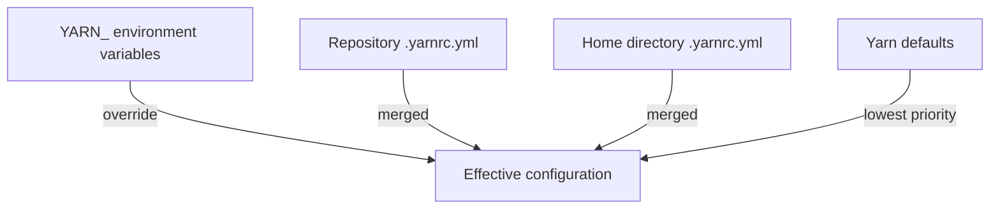

# The Yarn Configuration File And The Linker

Two projects with the same manifests and the same lockfile can still install differently if Yarn is configured differently. Yarn reads its settings from a file named `.yarnrc.yml` at the repository root. This part explains which Yarn release runs, which settings a Backstage repository sets, and how Yarn lays packages out on disk.

## Which Yarn release runs

Yarn is a package manager: a program that reads manifests, downloads packages and writes a lockfile. Several major releases exist, and they behave differently. A Backstage repository pins one release so that every developer and every build server runs the same one. It uses two fields for that.

The `packageManager` field in the root `package.json` names the tool and its version, for example `yarn@4.4.1`. Corepack, a tool that ships with Node.js, reads that field and runs the named release. The `yarnPath` setting in `.yarnrc.yml` points to a release file committed in the repository, for example `.yarn/releases/yarn-4.4.1.cjs`. When `yarnPath` is set, the `yarn` command hands control to that file.

Print both values in the playground project:

<!-- astrona:playground:renew -->
```sh
cd /opt/portal
grep packageManager package.json
cat .yarnrc.yml
yarn --version
```

The version that `yarn --version` prints is the release that runs. If it differs from the `packageManager` field, the installed command and the pinned release disagree, and a build can behave differently from a laptop.

## The settings in .yarnrc.yml

The file is YAML. Each key is a Yarn setting. A new Backstage application sets a few of them, and a project adds more over time. Three matter for every repository.

The `nodeLinker` setting decides how Yarn writes installed packages to disk. The value `node-modules` makes Yarn create a `node_modules` folder, the layout that Node.js and most tools expect. Backstage tooling expects this layout. The other values, `pnp` and `pnpm`, store packages in other ways and are not used by a standard Backstage project.

The `yarnPath` setting is the release file described above. The `enableGlobalCache` setting decides where Yarn keeps downloaded package archives. When it is `true`, archives go to a cache folder in the home directory of the user and many projects share them. When it is `false`, archives go to `.yarn/cache` inside the project. The playground project sets it to `false`.

Read a setting with the `config` command, which prints the value that Yarn will use after it merges every source:

```sh
yarn config get nodeLinker
yarn config get enableGlobalCache
yarn config get cacheFolder
```

The `config get` command shows the effective value, so it also shows a value that a user-level file or an environment variable changed. This is the quickest way to find out why one machine behaves differently from another.

## Where Yarn finds settings

Yarn merges settings from several places. A `.yarnrc.yml` in a folder applies to that folder and all folders below it. A file in a parent folder applies too, and a file in a deeper folder wins over a file higher up. A `.yarnrc.yml` in the home directory of the user holds personal settings such as an authentication token. An environment variable named `YARN_` plus the setting in upper case, for example `YARN_ENABLE_GLOBAL_CACHE`, overrides the files.

This order explains a common surprise. A setting that the repository file does not mention can still come from the home directory or from the environment of the build server. When a result differs between two machines, compare the output of `yarn config` on both.



The diagram shows that environment variables win over files, and that files win over the built-in defaults.

## What the linker produces

After `yarn install`, the layout on disk follows from `nodeLinker`. With `node-modules`, Yarn places one copy of each package at the root `node_modules` folder when the versions allow it. This is hoisting. A package that two workspaces need at different versions stays in the `node_modules` folder of the workspace that needs the other version.

Yarn also writes an install state file, `.yarn/install-state.gz`, that records what the last install did. You do not edit it, and a project normally does not commit it. List what the install created:

```sh
ls node_modules | head
ls .yarn
```

You see the `node_modules` folder with the installed packages and the workspace packages linked by name. The `.yarn` folder holds the pinned release and, because `enableGlobalCache` is `false`, the cache folder.

Which of these files belong in version control follows from their job. The manifests, the lockfile, `.yarnrc.yml` and the release file under `.yarn/releases` are inputs that describe the project, so a repository commits them. The `node_modules` folder and the install state are outputs, so a repository lists them in `.gitignore`.

You now know which Yarn release runs, where its settings come from and what the linker writes. The next question is how a dependency gets into one workspace without disturbing the others.

## Common pitfalls

> [!WARNING]
> - Running a different Yarn release than the one the project pins. Check `yarn --version` before you judge a lockfile difference.
> - Changing `nodeLinker` to `pnp` in a Backstage repository. Backstage tooling expects a `node_modules` folder, so many commands fail.
> - Reading only the repository `.yarnrc.yml` and forgetting the home directory file and the `YARN_` environment variables. Use `yarn config get` to see the effective value.
> - Committing the `node_modules` folder. It is an output, and the lockfile already describes it.
