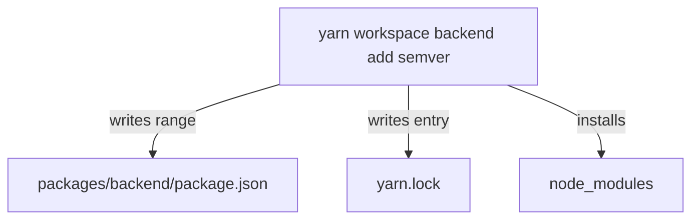

# Adding And Removing Dependencies In A Workspace

A Backstage repository holds several packages, and each one has its own list of dependencies. When a developer needs a new library, the library must land in the manifest of the workspace that imports it, and the lockfile must change with it. This part shows the commands that do both steps in one action, and the commands that change or remove a dependency later.

## Adding a dependency to one workspace

The command `yarn add` resolves a package, writes its range into a manifest, updates `yarn.lock` and installs the package. The question is which manifest it writes to. In Yarn 4, the answer depends on where you run it, or on the `workspace` command.

The form `yarn workspace <name> add <package>` runs from any folder and names the target by the `name` field of its manifest. Add the `semver` library to the backend package of the playground project:

<!-- astrona:playground:renew -->
```sh
cd /opt/portal
yarn workspace backend add semver
git diff --stat 2>/dev/null || true
grep -A3 '"dependencies"' packages/backend/package.json
```

Yarn writes `"semver": "^7.x.y"` under `dependencies` in `packages/backend/package.json`. The range starts with a caret, followed by the release that was current when you ran the command. The lockfile gains an entry for the `semver` package and an entry for the `backend` workspace that lists it.

Running `yarn add semver` from inside `packages/backend` has the same effect, because Yarn 4 finds the workspace that contains the current folder. The `--cwd` option belongs to Yarn 1, the classic release, where `yarn --cwd packages/backend add semver` was the way to target a folder. A repository that pins Yarn 4 uses `yarn workspace` instead.

## Choosing the dependency field

A manifest has several dependency fields, and the field decides when the package is needed. Use `dependencies` for a package that the code imports when it runs. Use `devDependencies` for a package that only the development workflow needs, such as a test runner or a type definition package. The flag `-D` (long form `--dev`) selects that field.

```sh
yarn workspace app add --dev typescript
```

Two more flags control the range. The flag `-E` (`--exact`) writes the exact version without a caret, so the range allows only that release. The flag `-T` (`--tilde`) writes a range that allows patch releases only. A Backstage repository that wants every developer to get the same release of a tool uses an exact version for that tool, and relies on the lockfile for the rest.

## Local packages with the workspace protocol

A package can depend on another package of the same repository. The range uses the `workspace:` protocol, for example `workspace:^`. With this range Yarn links the local package and never asks a registry for it. When Yarn publishes or packs the package, it replaces the protocol with the real version number.

```sh
yarn workspace backend add @internal/shared@workspace:^
```

After this command the backend manifest lists `@internal/shared` with the range `workspace:^`, and the lockfile records the link. The package must exist as a workspace, otherwise Yarn reports that it cannot resolve the name.

## Changing and removing dependencies

Three commands cover the rest of the life of a dependency. The command `yarn up <package>` raises the range and the lockfile entry to the newest release that Yarn allows, in every workspace that uses the package. The flag `-R` (`--recursive`) also updates the packages that depend on it. The command `yarn remove <package>` deletes the entry from the manifest of the workspace and updates the lockfile. The command `yarn workspace <name> remove <package>` does the same for a named workspace.

```sh
yarn workspace backend remove semver
yarn workspace backend add semver@^7.6.0
```

The second line shows that an `add` command accepts a range after the name. Yarn writes that range instead of the newest release. After a change like this, run `yarn install --immutable`. If the command succeeds, the manifests and the lockfile agree, and the change is ready for a commit.



The diagram shows that one `add` command changes two files that you commit and one folder that you do not.

## Check what the change did

After any change, ask Yarn who now depends on a package and which version it selected:

```sh
yarn why semver
yarn workspaces list
```

The `why` command prints each package that asks for `semver`, the range it uses and the version Yarn selected. The `workspaces list` command prints every workspace of the project. Together they show that the new dependency belongs to the workspace you intended and to no other.

You can now put a dependency in the right workspace and keep the lockfile in step. The next question is how to run one script across all of those workspaces.

## Common pitfalls

> [!WARNING]
> - Adding a package at the repository root because it is quick. The code in a workspace then works only because of hoisting, and a production install can leave the package out.
> - Using `--cwd` with Yarn 4. It is a Yarn 1 option. Use `yarn workspace <name> add` or run the command inside the workspace folder.
> - Editing a manifest by hand and not running `yarn install`. `yarn install --immutable` then fails because the lockfile does not match.
> - Putting a runtime library in `devDependencies`. A production install that skips development packages then leaves it out.
