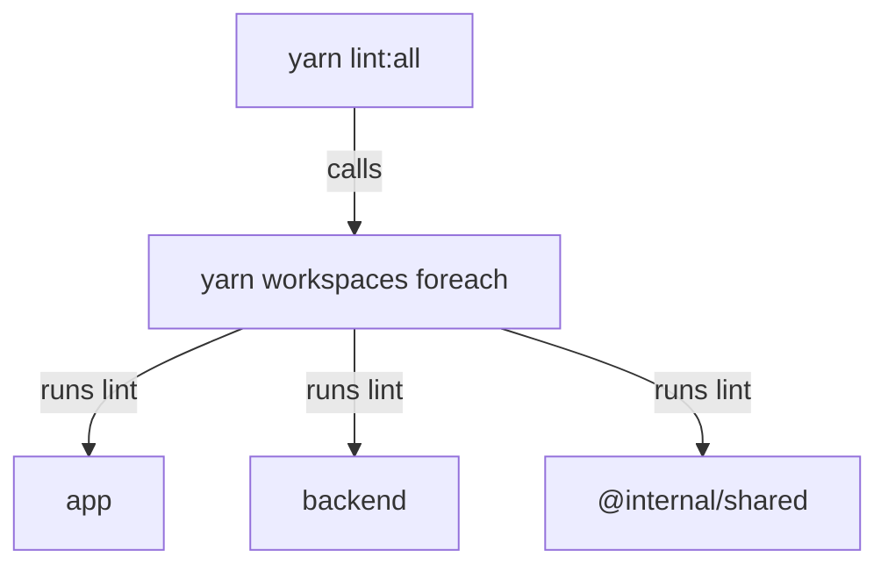

# Running Scripts Across Workspaces

A change in a Backstage repository can affect the app, the backend and several plugins. A developer wants one command that lints, type checks or builds all of them. This part explains how Yarn runs a script in one workspace, how `yarn workspaces foreach` runs it in many, and how to control the order and the scope of the run.

## Running a script in one workspace

A script is a named shell command in the `scripts` field of a manifest. The command `yarn run <script>` runs it for the workspace of the current folder. The command `yarn workspace <name> run <script>` runs it for the named workspace from any folder. Yarn sets the current folder to the workspace folder before it starts the command, so paths inside the script are relative to the package.

Run the lint script of one package in the playground project:

<!-- astrona:playground:renew -->
```sh
cd /opt/portal
yarn workspace backend run lint
```

The playground scripts only print a line that names their package, so the output shows which workspace ran. In a real Backstage repository, the same pattern runs the real tools.

Yarn also puts the executables of installed packages on the path of a script. A script that calls `backstage-cli` finds it in `node_modules/.bin` even though the command is not installed on the machine. This is why Backstage repositories call tools through `yarn`, for example `yarn backstage-cli repo lint`.

## Running a script in every workspace

The command `yarn workspaces foreach` runs a Yarn command in several workspaces. The flag `-A` (`--all`) selects every workspace of the project. Run the lint script everywhere:

```sh
yarn workspaces foreach -A run lint
```

Yarn runs the script once per workspace and prints the output of each, prefixed with the workspace name. If a script exits with a non-zero code in one workspace, `foreach` stops and returns a non-zero exit code, so a build server sees the failure. Reading the prefix on each line tells you which workspace printed it.

## Order, parallelism and scope

By default `foreach` runs the workspaces one after another. Three flags change that.

The flag `-t` (`--topological`) makes Yarn run a workspace only after the workspaces it depends on have finished. A build needs this: the backend imports the output of the shared package, so the shared package must be built first. The flag `-p` (`--parallel`) runs workspaces at the same time, which is faster for independent work such as lint. With `--parallel` the flag `-j` (`--jobs`) limits how many run together. The flag `-v` (`--verbose`) prints the start and the end of each workspace.

```sh
yarn workspaces foreach -A --topological run build
yarn workspaces foreach -A --parallel --jobs 2 run lint
```

Two flags restrict the scope. The flag `--include <pattern>` selects workspaces by name or folder, and `--exclude <pattern>` removes some. The flag `--since` selects only the workspaces that changed compared to a Git reference, which saves time on a build server that checks a small change.

```sh
yarn workspaces foreach -A --include 'packages/b*' run lint
```

The pattern accepts wildcards. The command above runs the script only in workspaces whose folder matches `packages/b*`, for example `packages/backend`.

## Root scripts that wrap foreach

A repository rarely asks developers to type the long form. It puts the command into a root script, so that everyone runs the same thing:

```json
"scripts": {
  "lint:all": "yarn workspaces foreach -A run lint",
  "build:all": "yarn workspaces foreach -A --topological run build"
}
```

A developer then runs `yarn lint:all`. A generated Backstage project uses the same idea, with its own command, `backstage-cli repo`, that knows the package graph and runs a task in dependency order. Both approaches do the same job: one entry point, one exit code.



The diagram shows one root script that fans out to one run per workspace.

Run the root script and then check its exit code:

```sh
yarn lint:all
echo "exit code: $?"
```

An exit code of zero means every workspace passed. A build server reads only this code, so a root script is a reliable gate.

You can now run one task over the whole repository, in the right order. The last question is how a Backstage repository keeps all of its `@backstage` packages at versions that belong together.

## Common pitfalls

> [!WARNING]
> - Running a build with `foreach` and no `--topological`. A workspace can start before the package it imports is built, and the failure looks like a missing module.
> - Using `--parallel` for tasks that write to the same folder. They overwrite each other.
> - Calling a tool such as `tsc` without `yarn`. The command is not on the path of the machine, and the version can differ from the pinned one.
> - Ignoring the exit code. A script wrapper that swallows a failure makes the build look green.
