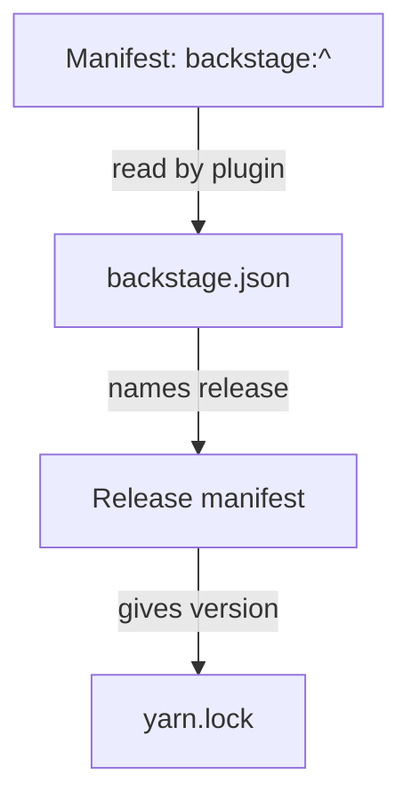

# The backstage.json File And The backstage: Protocol

A Backstage repository depends on dozens of packages in the `@backstage` scope. They are released together and tested together. If one package is at an old release and another at a new one, the application can fail in ways that no single package explains. This part explains how the repository records which Backstage release it is on, and how a newer Yarn feature lets manifests use that record instead of repeating version numbers.

## The backstage.json file

The file `backstage.json` sits at the repository root. It holds one field, `version`, with the Backstage release that the repository was last set to. A generated application creates it, and the upgrade command described in the next module rewrites it.

Print the file in the playground project:

<!-- astrona:playground:renew -->
```sh
cd /opt/portal
cat backstage.json
```

The file says, for example, `{ "version": "1.30.0" }`. It does not install anything. It is a record, and tools read it. The upgrade command reads it to know where the repository starts. A developer reads it to know which release notes apply. Because it is a plain file in the repository, a pull request that changes it shows that the Backstage release changed.

The record can become wrong. If a developer edits a version range in a manifest by hand, `backstage.json` still names the old release. Then the file and the installed packages disagree, and the file no longer says what the project runs.

## Where the Backstage versions live

Each Backstage release is a set of package versions that belong together. The Backstage project publishes this set as a release manifest: a list that maps each `@backstage` package name to one version. In a repository that does not use the protocol below, every manifest holds its own range for each `@backstage` package, for example `"@backstage/core-components": "^0.14.10"`. A single upgrade then rewrites many manifests.

That layout has a cost. The same package appears in the app, the backend and several plugin manifests, and each range must be changed in the same pull request. A missed manifest leaves one workspace on an older release.

## The backstage: protocol

Recent Backstage releases support a different layout. A manifest writes the range `backstage:^` for a `@backstage` package, with no version number:

```json
"dependencies": {
  "@backstage/core-components": "backstage:^"
}
```

When Yarn resolves this range, a Yarn plugin reads `backstage.json`, finds the release it names, looks up the package in the release manifest for that release and substitutes the version it finds. Yarn then writes the resolved version into `yarn.lock`. The version number lives in one place, `backstage.json`, and the manifests never change during an upgrade.

The plugin is a Yarn plugin: an extension that adds a resolver for a new protocol. A project enables it in `.yarnrc.yml` under `plugins`. The release manifest is fetched from a Backstage server, so the first resolution needs network access. A repository that has not enabled the plugin must keep plain version ranges, and Yarn reports an unsupported protocol if it meets `backstage:^` without the plugin.



The diagram shows that the version in the lockfile comes from the release named in `backstage.json`, not from the manifest.

## What to check in a repository

Two quick checks tell you which layout a repository uses. Search the manifests for the protocol, and read the plugin list in `.yarnrc.yml`:

```sh
grep -rn 'backstage:' --include=package.json packages | head
grep -n plugins -A3 .yarnrc.yml || echo "no plugins entry"
```

If the first command prints lines, the manifests use the protocol, and the second command shows the plugin that resolves it. If both are empty, the repository uses plain ranges and the upgrade rewrites every manifest. The playground project uses plain ranges and has no plugin, so both searches print nothing useful there, and the commands only show the pattern.

Whichever layout a repository uses, `yarn install --immutable` still reproduces the result from `yarn.lock`. The protocol changes where the version comes from, not how the install verifies it.

You can now read the Yarn configuration, add dependencies to the right workspace, run scripts across the repository and explain where the Backstage release is recorded. These are the daily tools for working with dependencies in a Backstage repository.

## Common pitfalls

> [!WARNING]
> - Editing `@backstage` ranges by hand and leaving `backstage.json` unchanged. The record then names a release the project no longer runs.
> - Writing `backstage:^` in a repository that has not enabled the Yarn plugin. Yarn cannot resolve the protocol.
> - Expecting `backstage.json` to install packages. It only records a release.
> - Mixing `backstage:^` for some `@backstage` packages with fixed versions for others. The packages then come from different releases.
