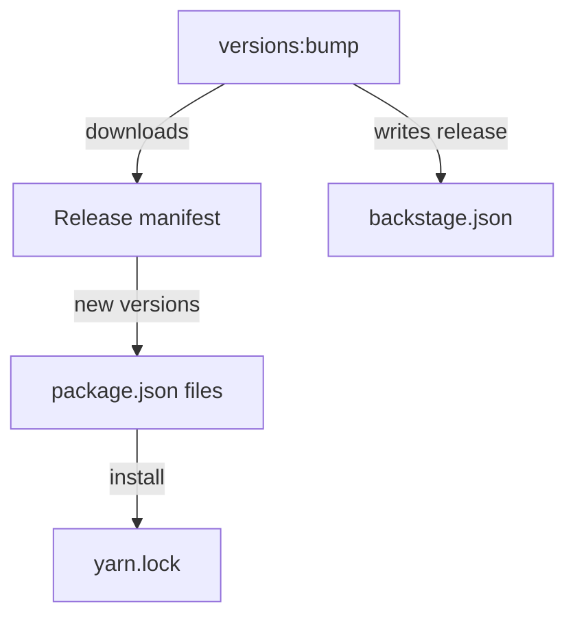

# Upgrading Backstage With versions:bump

A Backstage release changes dozens of packages at once. Changing each range by hand is slow and error-prone, and one missed package can leave the application on mixed releases. The Backstage command-line tool, `backstage-cli`, has a command that moves the whole repository to one release. This part explains what that command changes, how to run it and how to review its result.

## What the command does

The command is `yarn backstage-cli versions:bump`. It runs from the repository root. Backstage publishes a release manifest for each release: a list that maps every `@backstage` package to the version that belongs to that release. The command downloads the manifest for the target release, compares it with the versions in the manifests of the repository and rewrites the ranges that differ. It also writes the new release number to `backstage.json`.

After it changes the manifests, the command runs the install step, so that `yarn.lock` and `node_modules` match the new ranges. The result is a set of changed files: every `package.json` that holds a `@backstage` range, `backstage.json` and `yarn.lock`.

By default the command targets the newest stable release. Three options change the target. The option `--release <version>` selects a specific release, for example `--release 1.30.0`. The value `next` selects the latest prerelease. The option `--pattern` changes which package names the command bumps, so that a repository can include plugins from other scopes that publish a release manifest.

Because the command needs the release manifest, it needs network access. The playground has none of the real packages, so this part describes the command and uses the playground only to read the files that it changes.

## Reading the files before an upgrade

Start every upgrade from a clean working tree, so that the changes belong to the upgrade alone. Print the current release and the `@backstage` ranges of the example project:

<!-- astrona:playground:renew -->
```sh
cd /opt/portal
cat backstage.json
grep -rn '@backstage' --include=package.json packages || echo "no @backstage ranges in the fixture"
git status --short 2>/dev/null || echo "not a Git repository"
```

The fixture holds no `@backstage` packages, so the search prints the fallback message. In a real repository the search lists the same package in several manifests, which shows why a command is better than manual edits.

## What a bump can change besides ranges

A new Backstage release can change more than version numbers. Two kinds of change matter in a review.

First, a release can need a code change. A package can rename an export, move a plugin to a new backend system or remove a deprecated option. The compile step and the tests find these. The release notes list them, and the upgrade helper that the Backstage project publishes shows the file differences between two releases of a generated application.

Second, a release can change files that are not dependencies: the template files of a generated application, such as `app-config.yaml` defaults or the `Dockerfile`. The `bump` command does not rewrite those files. A maintainer compares them with the new template by hand.

A related command, `yarn backstage-cli versions:check`, reports packages that exist in more than one version in the lockfile. Run it after a bump to find duplicates that the new ranges introduced. The next part shows how to resolve them.



The diagram shows that one command changes the manifests, the release record and, through the install, the lockfile.

## A safe upgrade routine

An upgrade is a normal change, so it follows the normal checks. A reliable routine has five steps.

1. Create a branch and confirm that the tree is clean.
2. Run `yarn backstage-cli versions:bump`.
3. Run `yarn install --immutable` to confirm that the files agree.
4. Run the type check, the tests and the build for every workspace.
5. Read the release notes for breaking changes, fix them and commit the manifests, `backstage.json` and `yarn.lock` together.

Steps three and four prove different things. The immutable install proves that the lockfile matches the manifests. The compile, test and build steps prove that the code still works with the new packages. An upgrade that passes only step three is not finished.

You can now move a repository to a new Backstage release and say what to check afterwards. The next question is what to do when the lockfile still contains several versions of one package.

## Common pitfalls

> [!WARNING]
> - Running the bump on a branch with unrelated changes. The upgrade diff then hides them, and a review cannot separate the two.
> - Committing the manifests without `yarn.lock` or `backstage.json`. Other developers install a different graph.
> - Skipping a release and jumping several at once without reading the notes. Breaking changes pile up and are harder to find.
> - Treating a green install as a finished upgrade. The install does not compile or test the code.
