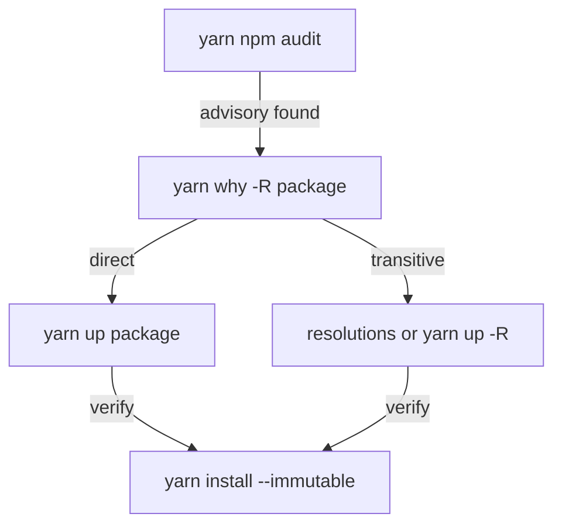

# Finding Duplicate And Vulnerable Packages

A Backstage repository installs hundreds of packages, and most of them arrive as dependencies of dependencies. Two problems follow. The same package can be installed in several versions, which makes the install larger and can break code that expects one copy. And a package can have a published security advisory that nobody on the team asked for. This part shows the commands that find the cause and the options that fix it.

## Finding why a package is installed

A transitive dependency is a package that the project does not list itself but that another dependency needs. The command `yarn why <package>` explains one. It prints each package that asks for it, the range that package uses and the version that Yarn selected. The flag `-R` (`--recursive`) follows the chain up to the workspace that started it.

Run it in the playground project, where the `semver` library is installed:

<!-- astrona:playground:renew -->
```sh
cd /opt/portal
yarn why semver
yarn why -R semver
```

The first command lists the direct requests. The second adds the chain, so you can tell whether a workspace asked for `semver` or whether another package did. The answer decides the fix: a direct dependency changes in the manifest of the workspace, and a transitive one needs a different tool.

## Finding duplicates

A duplicate is a package that appears in the lockfile at two or more resolved versions. It happens when two ranges cannot be satisfied by one release, or when a lockfile keeps an older entry that a newer range could also use. List the entries for one package:

```sh
grep -n '^"semver@' yarn.lock
```

Each line is one lockfile entry key. Entries that share one resolved version appear on the same line, joined by commas. Two separate lines for the same name mean two separate resolved versions.

The command `yarn dedupe` rewrites the lockfile so that packages use an already-selected version when their range allows it. The option `--check` does not write anything: it exits with a non-zero code if a dedupe would change the lockfile, so a build can enforce it. The option `--strategy highest` selects the newest compatible version, instead of the default that keeps the versions that are already in use.

```sh
yarn dedupe --check
echo "exit code: $?"
```

A zero exit code means no duplicate can be merged. After a bump, run `yarn dedupe` and then `yarn install --immutable`, and commit the lockfile change.

## Forcing a version with resolutions

Some duplicates cannot be merged because two packages really ask for incompatible ranges. A fix that does not change their manifests is the `resolutions` field of the root manifest. It maps a package name to a version, and Yarn uses that version wherever the package appears, whatever range the dependants ask for.

```json
"resolutions": {
  "semver": "^7.6.0"
}
```

Use it with care. A resolution overrides the range that the author of the dependant tested. It can work today and break at the next upgrade of that dependant. A comment in the pull request that says why the entry exists, and when it can go, keeps it from becoming permanent.

## Reporting vulnerabilities

A security advisory is a published report that a version range of a package contains a vulnerability. The command `yarn npm audit` sends the dependency tree to the registry and prints the advisories that match. Useful options narrow the report: `--recursive` includes every workspace, `--environment production` ignores development tools, `--severity moderate` hides lower findings and `--json` prints a result that other programs can read.

```sh
yarn npm audit --recursive --environment production
echo "exit code: $?"
```

The command needs network access to a registry that supports the audit endpoint. When it finds an advisory at or above the severity, it exits with a non-zero code. In a build, that code can stop a release.

An advisory has a fix in one of three places. The advisory can name a patched release that the direct dependency already allows, so `yarn up <package>` updates it. It can sit in a transitive package, where `yarn up -R <package>` or a `resolutions` entry selects the patched release. Or no patched release exists yet, and the team decides to accept the risk or replace the package.



The diagram shows that the cause found by `why` decides which fix to use, and that every fix ends with the immutable install.

You now know how to explain an installed package, merge duplicates and act on an advisory. The next topic is a kind of dependency that behaves differently: the peer dependency of a plugin.

## Common pitfalls

> [!WARNING]
> - Using `resolutions` to silence a warning without understanding it. The forced version can be incompatible with the package that asked for another one.
> - Running `yarn npm audit` once and never again. New advisories appear for versions that were clean before.
> - Auditing development tools as if they ran in production. Use `--environment production` for the runtime question.
> - Running `yarn dedupe` and not committing the changed lockfile. The next install differs from what you tested.
