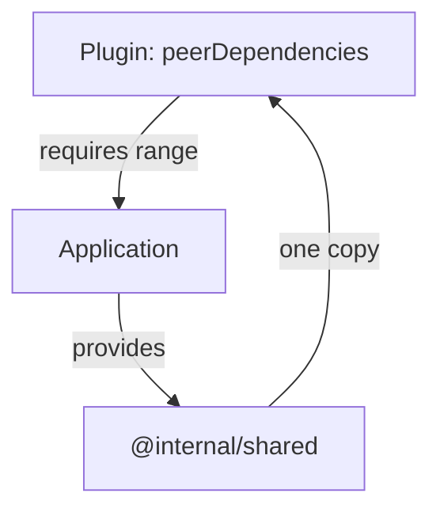

# Peer Dependencies In Plugins

A Backstage plugin runs inside an application, and it uses libraries that the application also uses, such as React or the shared Backstage packages. If the plugin installed its own copy of such a library, the application would load two copies, and shared state would split between them. A peer dependency solves this. This part explains what a peer dependency declares, who satisfies it and what Yarn reports when it is missing.

## Dependencies, devDependencies and peerDependencies

The three fields answer different questions. The field `dependencies` says: install this package for me. The field `devDependencies` says: install this only while developing me. The field `peerDependencies` says: I need this package, but the project that uses me must install it, and its version must satisfy this range.

A peer dependency installs nothing for the package that declares it. It is a requirement on the consumer. The consumer is the application or the package that lists the plugin in its own `dependencies`.

Read the plugin manifest in the playground project:

<!-- astrona:playground:renew -->
```sh
cd /opt/portal
cat packages/plugin/package.json
cat packages/app/package.json
```

The plugin declares `@internal/shared` under `peerDependencies`, and the application declares both the plugin and `@internal/shared` under `dependencies`. The application satisfies the plugin requirement.

## Why a plugin also lists the peer in devDependencies

While a developer works on the plugin alone, nothing else installs the peer. Tests and the compiler need it, so the plugin lists the same package in `devDependencies` too. With the `workspace:` protocol, a plugin in the same repository writes `"@internal/shared": "workspace:^"` in `devDependencies` and a range such as `"^1.0.0"` in `peerDependencies`.

The two entries serve different readers. The peer range tells every consumer what it must provide. The development entry makes the plugin build and test on its own. The peer range uses a normal version range, not the `workspace:` protocol, because consumers outside the repository must be able to read it.

## What the consumer must do

When the application depends on the plugin, Yarn checks every peer dependency of the plugin against what the application provides. Three outcomes are possible. If the application provides a matching version, nothing is reported. If the application does not provide the package, Yarn prints a warning during the install, because the requirement is not met. If the application provides a version outside the range, Yarn prints a warning about the incompatible version.

These are warnings, not errors, so the install can still exit with code zero. The failure shows later, when the code runs and imports a package that is missing or of the wrong version. A reliable repository reads the install output and fixes peer warnings instead of ignoring them.

List every unmet requirement of the project with one command:

```sh
yarn explain peer-requirements
```

The command prints one line per peer requirement and says whether it is met. Add a package name as an argument to explain one requirement in detail.



The diagram shows that the application provides one copy of the shared package and the plugin uses that copy.

## Backstage plugins in practice

In a real Backstage repository, plugin packages declare `react`, `react-dom` and sometimes `@backstage/core-plugin-api` as peer dependencies. A frontend plugin is imported into the single application bundle, so two copies of the React package would break hooks. The application supplies one copy for all plugins.

A practical rule for authors follows from this. Put a library in `peerDependencies` when it must exist once at runtime and the application owns it. Put it in `dependencies` when the plugin owns its private use of it and a second copy would do no harm.

You can now say who provides a peer dependency and where a missing one shows up. The last topic is how Yarn finds packages that do not live on the public registry.

## Common pitfalls

> [!WARNING]
> - Declaring a shared library in `dependencies` of a plugin. The application then loads two copies of it.
> - Declaring a peer dependency without the matching `devDependencies` entry. The plugin cannot be built or tested alone.
> - Ignoring peer warnings during the install because the exit code is zero. The error appears later, at run time.
> - Using the `workspace:` protocol in a peer range. A consumer outside the repository cannot resolve it.
