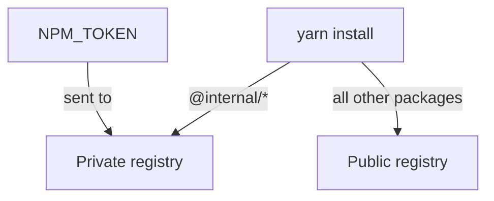

# Private Registries And Authentication

A company often publishes its own packages, such as shared plugins, to a private registry. A registry is a server that stores package archives and answers requests for them by name and version. The public npm registry is the default. This part explains how Yarn is told to use another registry for some packages, how it authenticates and how to keep the token out of the repository.

## The default registry and the setting that changes it

Yarn sends every package request to the server in the `npmRegistryServer` setting. Its default is the public npm registry. Print the value in the playground project:

<!-- astrona:playground:renew -->
```sh
cd /opt/portal
yarn config get npmRegistryServer
```

Setting this value at the top level of `.yarnrc.yml` sends every package to the new server. That is correct for a company mirror that proxies the public registry. It is wrong for a registry that holds only internal packages, because requests for public packages would fail there.

## Routing one scope to a private registry

A scope is the prefix before the slash in a package name, such as `@internal` in `@internal/shared`. The `npmScopes` setting maps a scope to its own registry settings. Packages in that scope go to the named server, and all other packages keep the default.

Save this as `.yarnrc.yml`, merged with the lines that the file already has:

```yaml
npmScopes:
  internal:
    npmRegistryServer: "https://npm.internal.example.com"
    npmAlwaysAuth: true
    npmAuthToken: "${NPM_TOKEN:-}"
```

The scope key is written without the at sign. The setting `npmAlwaysAuth` makes Yarn send the token on every request to that server, including the metadata requests that a registry may otherwise treat as public. The `${NPM_TOKEN:-}` form reads the environment variable `NPM_TOKEN` and falls back to an empty value when it is not set, so a developer without the token can still run commands that do not need it.

Then check what Yarn will use for the scope:

```sh
yarn config get npmScopes
```

Packages that are workspaces of the repository do not touch the registry at all, because the `workspace:` protocol resolves them locally. The setting matters only for packages that Yarn must download.

## Authentication without committing a secret

A token is a secret string that proves the identity of the caller. A token in a file that is committed is visible to everyone who can read the repository and to everyone who ever could, because version control keeps history. Three places keep the secret out of the repository.

The environment variable form above reads the token from the shell or from a secret store of the build server. A `.yarnrc.yml` in the home directory of the user holds personal tokens, outside any repository. The command `yarn npm login` asks for credentials and stores the resulting token in that home directory file.

Yarn also accepts `npmAuthIdent` (a `user:password` pair, base64 encoded) in place of a token. Prefer a token, because it can be limited to reading packages and revoked on its own.



The diagram shows that Yarn picks the server by scope and sends the token only to the private one.

## Reading registry failures

The status code in the error identifies the cause. A `401` response means the registry did not accept the credentials or received none, so check the token and `npmAlwaysAuth`. A `403` response means the credentials are valid but the user may not read that package. A `404` response for a package that exists often means a private package was requested from the public registry, because the scope has no `npmScopes` entry. A connection error or a timeout points at the network, a proxy or a certificate. The settings `httpsProxy` and `httpsCaFilePath` configure a proxy and a company certificate authority file.

Run the install with the scope set and read its result:

```sh
yarn install --immutable
echo "exit code: $?"
```

Because every package of the playground project is local or already in the lockfile, the install does not need the private server. In a real repository, a missing token would show up here as a `401`.

Publishing uses a related setting. The setting `npmPublishRegistry` sets the server that `yarn npm publish` writes to, and the `publishConfig` field of a package manifest can set it for one package.

You now know how Yarn chooses a registry, how to authenticate without leaking a secret and how to read a registry failure. Together with upgrades, audits and peer dependencies, these cover how a Backstage repository keeps its dependencies installable and safe.

## Common pitfalls

> [!WARNING]
> - Writing the token itself into `.yarnrc.yml`. It stays in the Git history even after you delete the line, so revoke it and issue a new one.
> - Setting the top-level `npmRegistryServer` to a registry that holds only internal packages. Requests for public packages then fail.
> - Writing the scope with the at sign in `npmScopes`. The key is the scope name without it.
> - Using an `http` registry without adding it to `unsafeHttpWhitelist`. Yarn refuses plain `http` hosts by default.
