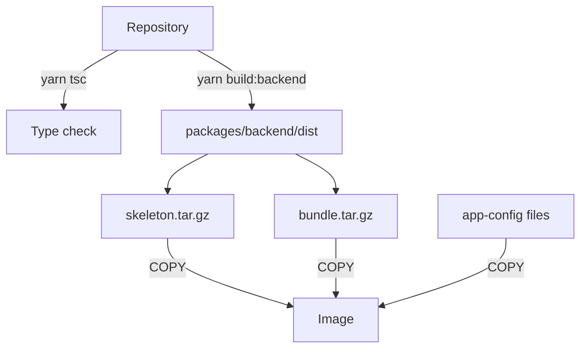

# What Goes Into A Backstage Image

A team has a Backstage project that runs well on every developer machine. Now the platform team must run the same backend on a server. The server has no checkout of the repository, no editor and no package cache. The team needs one file that contains everything the backend needs to start. That file is a container image, and this part explains what goes into it, which part of the system chooses the files, and why a wrong choice often builds successfully but fails later.

A **container image** is a read-only package that holds a filesystem and the instructions to start a process. Docker, the tool that builds and runs containers, reads a text file called a **Dockerfile** and runs its instructions in order. Each instruction that changes the filesystem creates a **layer**, a stored set of file changes. The finished image is the stack of all layers plus metadata such as the start command and the user.

## The artifact is the backend, not the repository

A Backstage project is a Yarn workspace, which is a repository that holds several packages. The `app` package builds the browser interface. The `backend` package runs the server: the catalog, the plugin routes and the integrations that need credentials. The standard image runs the backend. The backend can also serve the compiled frontend files when the project uses the app-backend plugin, so one container can deliver both the API and the pages.

The image does not need the TypeScript source, the editor settings, the test files or the Git history. It needs the compiled backend output, the production dependencies, the configuration files and a Node.js runtime. Everything else only makes the image larger and gives a possible attacker more to read.



The diagram shows that the image receives two archives from the backend build and the configuration files, not the repository. The backend build writes the archives into `packages/backend/dist`. The `skeleton.tar.gz` archive holds only the `package.json` files of the workspace packages. The `bundle.tar.gz` archive holds the compiled backend code and its package metadata. Splitting them lets Docker cache the dependency layer: the skeleton changes only when a dependency changes, while the bundle changes on every code change.

## The build context decides what Docker can see

When you run `docker image build`, the Docker client first sends a **build context** to the Docker daemon, the background service that does the build. The context is a directory, and the last path argument of the command names it. The daemon can read only files inside the context. A `COPY` instruction that names a file outside the context fails.

The command below uses the current directory as the context and a Dockerfile from a subdirectory. The tag `backstage` names the result.

```sh
docker image build . -f packages/backend/Dockerfile --tag backstage
```

The dot is the context. The `-f` flag selects the Dockerfile, which does not have to sit in the context root. The command only builds and tags the image on the local machine. It does not start the backend and it does not push anything to a registry.

## The ignore file shapes the context

A file named `.dockerignore` in the context root lists paths that the client leaves out of the context. It works like a `.gitignore` file, with one pattern per line. Leaving files out has three benefits. The context is smaller, so the transfer to the daemon is faster. Large directories such as `node_modules` do not enter the build. Files that must stay private, such as `app-config.local.yaml`, cannot be copied by accident.

The ignore file also has a risk, because it can remove a file the Dockerfile needs. In a host-build arrangement, where the bundle is built before Docker runs, the bundle in `packages/backend/dist` must stay in the context. A pattern such as `packages/*/dist` removes it, and the `COPY` of the bundle then fails with a message that the file is not found. The file exists on disk. The daemon cannot see it.

The opposite also happens. In an arrangement where Docker builds the backend itself, the source must stay in the context. A pattern such as `packages/*/src` that is correct for the host build breaks the second arrangement. The ignore file therefore belongs to one packaging approach and has to change with it.

## Dependencies and the base image

The Backstage documentation uses a Node.js base image from the official `node` repository. The Node.js version in the image must match the version used for the build, because compiled code and native modules depend on it. A native module is a dependency with code compiled for one operating system, processor architecture and Node.js version. A module that was compiled on a developer laptop may not load in a different Linux image.

Production installs only the packages the backend needs at run time. Development tools such as the TypeScript compiler stay out. A Yarn command can install only the production dependencies of the workspaces that the skeleton lists, which keeps the final layer smaller.

## Try it in the playground

The playground has a small portal workspace in `/opt/portal`. It has the same shape as a Backstage project, but it has no registry dependencies, so every step runs quickly. Its build script is named `build:backend` and plays the role of `yarn build:backend`. It writes only a `bundle.tar.gz`, because the workspace has no dependencies that need a skeleton.

<!-- astrona:playground:renew -->

Open a shell in the playground and build the bundle. The script packs the backend into one archive:

```sh
cd /opt/portal
npm run build:backend
```

List what the archive contains. The command reads the archive and prints its file names without unpacking it:

```sh
tar -tzf packages/backend/dist/bundle.tar.gz
```

The list shows the backend `package.json`, the backend entry file and a build identifier file. It does not show the source directory, the other packages or the `app-config.local.yaml` file. That is the content a host-build image receives.

Now look at the ignore file and at the secret file it should protect:

```sh
cat .dockerignore
ls app-config*.yaml
```

The ignore file lists `*.local.yaml`, so the developer-only file never enters the build context. Add the line `packages/*/dist` to `.dockerignore` and build the host-build image to see the failure:

```sh
echo 'packages/*/dist' >> .dockerignore
docker image build . -f packages/backend/Dockerfile --tag portal:host
```

The build stops at the instruction that copies the bundle, and the message says the file is missing from the context. Remove the line again so later steps work, either with an editor or by restoring the three original lines.

## What you know now

An image holds a filesystem and a start command. A Backstage image normally holds the compiled backend, its production dependencies, its configuration files and a Node.js runtime, and it does not hold the repository. The build context is the set of files the daemon may read, and the ignore file edits that set before the build starts. A wrong ignore pattern can hide a needed file or let a private file in. The open question is how the compiled output gets built and who builds it, which decides whether the image can contain stale code.

## Common pitfalls

> [!WARNING]
> A file that exists on disk is not always in the build context. When a `COPY` fails with "not found", read the ignore file before the Dockerfile. Do not copy a developer's whole working directory into an image: it can carry local configuration, tokens and a `node_modules` directory built for another system.
