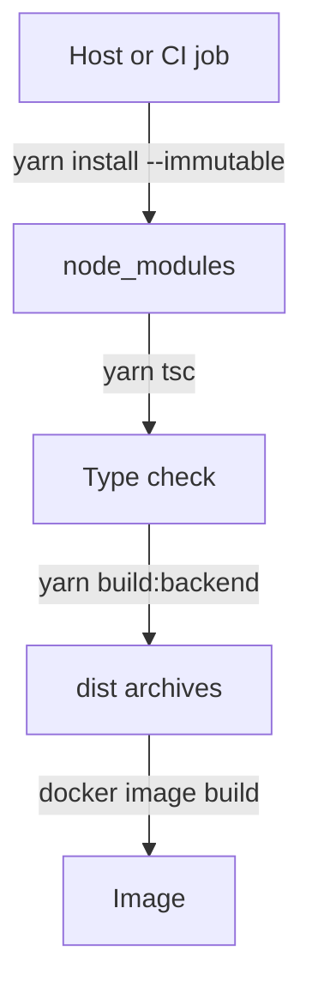
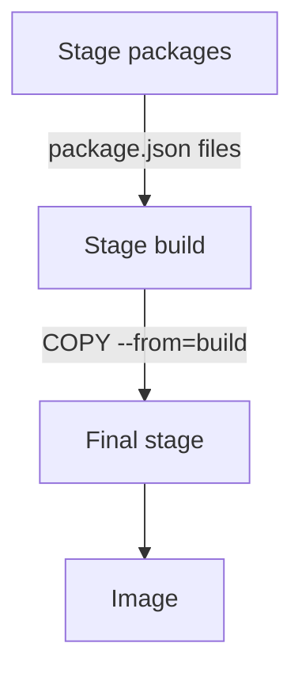

# Host Build And Multi-Stage Build

A Backstage image needs compiled output, and somebody has to compile it. There are two common answers. Either the compilation runs on the host machine or in the continuous integration job before Docker starts, or it runs inside Docker as an earlier stage of the same Dockerfile. This part compares both, shows where each one can go wrong, and explains which files each one needs in the build context.

## The host build

In a **host build**, the steps run on the machine that calls Docker, in this order. First `yarn install --immutable` installs the dependencies exactly as the lockfile records them. Then `yarn tsc` type-checks the whole project. Then `yarn build:backend` creates `skeleton.tar.gz` and `bundle.tar.gz` in `packages/backend/dist`. Only after those steps does `docker image build` run.

The Dockerfile of a host build is short because it does no compiling. It starts from a Node.js base image, switches to the unprivileged `node` user, sets `NODE_ENV` to `production`, unpacks the skeleton, installs the production dependencies, unpacks the bundle and sets the start command. The start command is `node packages/backend --config app-config.yaml --config app-config.production.yaml`.



The diagram shows that the archives exist before Docker starts. Docker only packages them.

This arrangement has two strengths. The host already has a dependency cache and the checks that the project runs for every change, so the image build reuses that work. The Dockerfile is also small and fast. The weakness is a prerequisite that Docker cannot check: the archives must exist and must match the source revision. If `packages/backend/dist` holds archives from an older commit, `docker image build` still succeeds and the image holds the old backend. Nothing in the build output marks the problem.

## The multi-stage build

A **multi-stage build** has more than one `FROM` instruction in one Dockerfile. Each `FROM` starts a new stage with its own filesystem. A later stage can copy files out of an earlier one with `COPY --from=<stage>`, and everything else in the earlier stage is thrown away when the build ends.

The Backstage multi-stage Dockerfile sits at the root of the repository and has three stages. The first stage copies only the `package.json` files so the dependency layer can be cached. The second stage installs all dependencies, runs `yarn tsc`, builds the backend and unpacks the archives. The last stage starts again from a clean Node.js base image, installs the production dependencies and copies the unpacked backend from the build stage. The final image is built from the last stage only.



The diagram shows that only the final stage becomes the image. The compiler, the development dependencies and the source stay in the build stage, which is discarded.

## What a multi-stage build does and does not guarantee

The separation holds only for what the final stage copies. The instruction `COPY --from=build /app /app` copies the whole build directory, so the source, the build scripts and any local configuration that entered the build context end up in the final image. The multi-stage structure is then only decoration. The rule is to copy named files from the build stage, such as the unpacked bundle and the two configuration files.

A multi-stage build also needs a different build context. The build stage compiles inside Docker, so the source must be in the context. An ignore pattern that removes `packages/*/src`, correct for a host build, makes the build stage fail on its first step that reads the source.

The provenance is stronger in a multi-stage build. The same `docker image build` command compiles and packages one revision of the context, so a stale bundle cannot come from an old `dist` directory. A stale `dist` directory can still enter the context, because the build stage overwrites it only if the build step runs. Excluding `packages/*/dist` in the ignore file of a multi-stage build removes that source of confusion.

## Choosing between them

A host build fits a project that already builds and checks on a continuous integration runner and wants the image step to be fast. It needs a rule that the image job uses the archives of the same commit, for example by running the build in the same job. A multi-stage build fits a project that wants the image build to need only Docker and the source. It is slower to run from scratch and needs good layer caching to stay fast. Neither one is more secure by itself. The base image, the copied files and the user decide that.

## Try it in the playground

The playground workspace has both kinds of Dockerfile. `packages/backend/Dockerfile` is a host build that unpacks `packages/backend/dist/bundle.tar.gz`. `Dockerfile.multistage` has a build stage that runs the build script and a final stage that copies only the bundle and two configuration files.

<!-- astrona:playground:renew -->

Build the host-build image. The context is `/opt/portal` and the Dockerfile comes from the backend package:

```sh
cd /opt/portal
npm run build:backend
docker image build . -f packages/backend/Dockerfile --tag portal:host
```

Build the multi-stage image from the same context with the other Dockerfile:

```sh
docker image build . -f Dockerfile.multistage --tag portal:multi
```

Compare the two images. `docker image ls` shows both tags, and `docker history` lists the layers of each image with the instruction that created each one:

```sh
docker image ls portal
docker history portal:multi
```

The history of the multi-stage image shows layers from the final stage only. The `RUN sh scripts/build-backend.sh` instruction of the build stage does not appear. Now check what the final image holds, using a throwaway container that lists the working directory and exits:

```sh
docker run --rm --entrypoint ls portal:multi /app
```

The listing shows the `packages` directory and the two configuration files. It does not show `scripts`. To see the stale-bundle risk, change the build identifier in the source and build the host image again without rebuilding the bundle:

```sh
echo r3 > packages/backend/src/build-id
docker image build . -f packages/backend/Dockerfile --tag portal:stale
docker run --rm --entrypoint cat portal:stale /app/packages/backend/dist/build-id
```

The build succeeds, and the file inside the image still shows the old identifier, not `r3`. Restore the file with `echo r2 > packages/backend/src/build-id` and run `npm run build:backend` to leave the workspace consistent.

## What you know now

A host build compiles before Docker and packages archives, so it is fast and reuses existing checks but depends on archives that match the source. A multi-stage build compiles inside Docker and copies selected files into a clean final stage, which removes build tools only when the copy is selective. Each approach needs its own ignore file. The open question is what the running container needs from outside the image, and which parts of that are not proved by a finished build.

## Common pitfalls

> [!WARNING]
> A successful build does not prove that the image holds the code you meant to ship. A host build can package stale archives without any message. A multi-stage build that copies the whole build directory carries the source and local files into the final image. Check the content of the image, not only the exit code of the build.
