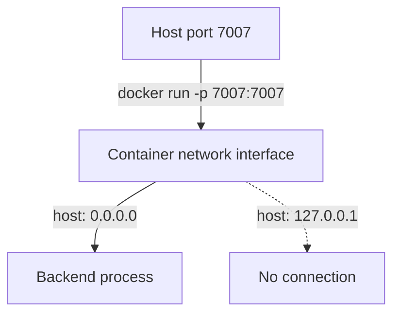

# Runtime Configuration, Identity And What A Build Proves

The image is built and tagged. A team member says the work is done, because the build exited with success. This part explains what the image build did not decide: which configuration the running container reads, which user it runs as, how a secret reaches it, and which checks show that the container works. These questions decide whether an image that built correctly also runs correctly.

## Configuration at run time

Backstage reads its configuration from YAML files named with repeated `--config` flags. Later files override earlier ones. A project normally has `app-config.yaml` for shared settings and `app-config.production.yaml` for the production values. A third file, `app-config.local.yaml`, holds developer-only overrides and is read by the development commands automatically. The image start command lists the files it wants. In the standard Dockerfile the command is `node packages/backend --config app-config.yaml --config app-config.production.yaml`. The local file is not named there, and it should not be in the image at all.

The files in the image provide defaults for that environment. Values that differ between deployments, such as the database host or a token, should come from outside the image when the container starts. Backstage reads environment variables inside configuration files through a substitution syntax, and it accepts configuration values through variables whose names begin with `APP_CONFIG_`. Whatever the exact mechanism, the container receives the value at start, so the same image can run in every environment.

The start command and the files together decide the network behavior. In the portal example, `app-config.yaml` makes the server listen on the loopback address `127.0.0.1`, and `app-config.production.yaml` changes the listen host to `0.0.0.0`. A server that listens on the loopback address inside a container accepts connections only from inside that container. Publishing a port with `-p 7007:7007` forwards traffic to the container network interface, where nothing listens, so the connection fails even though the process is running. If the start command leaves out the production file, this exact failure happens.



The diagram shows that published traffic reaches the container interface, and only a process bound to all interfaces receives it. The dotted line is the loopback case, where the process receives nothing.

## Identity: which user runs the process

By default a container process runs as root, the user with id 0 inside the container. Root inside a container is not the same as root on the host, but it has wide rights inside the container's filesystem, and a mistake in the container runtime or a mounted path can turn that into a host problem. The standard Backstage Dockerfile switches to the `node` user that the base image provides. This user has no rights outside its own files.

The switch needs care. Docker creates the `WORKDIR` directory owned by root. A process running as `node` cannot write there. The Dockerfile therefore changes the owner of the directory with `RUN chown node:node /app` before the `USER` instruction, or it uses `COPY --chown=node:node` for the files it adds. A `USER` line with no matching ownership produces a different failure: the build fails when a later instruction tries to write.

## Secrets and layers

A **layer** is permanent. A file that a `COPY` instruction adds stays in that layer, even when a later `RUN rm` removes it, because the later layer only marks the file as deleted and the earlier layer still holds the bytes. Anyone who can pull the image can read the earlier layer. The same applies to `ENV` and `ARG` instructions: their values are stored in the image metadata and history.

A token baked into an image is therefore spread to every registry, cache and machine that holds the image. The safe rule has two parts. Keep secret files out of the build context with `.dockerignore`, and name copied files one by one instead of using a pattern such as `COPY app-config*.yaml ./`, which also matches the local file. Pass secret values at run time with `docker run -e NAME=value` or through the orchestrator's secret mechanism.

## What a finished build does not prove

A successful `docker image build` proves that the instructions ran and the layers were stored. It does not prove that the database is reachable from where the container runs, that the ingress sends traffic to the right port, that the identity provider accepts the redirect address, or that plugins have permission to call their external services. Those are separate checks, each with its own evidence.

Useful evidence for the image itself is cheap. `docker image inspect` prints the metadata: the user, the exposed port, the environment and the command. `docker history` lists the layers and the instructions that created them. A throwaway container with `--entrypoint` can list files or read one. A health request to the published port shows that the process started and listens where expected. Each one answers one question, and none answers all of them.

## Try it in the playground

<!-- astrona:playground:renew -->

Start a container from the host-build image. The command publishes container port 7007 on the host and passes a token at run time:

```sh
cd /opt/portal
docker image build . -f packages/backend/Dockerfile --tag portal:host
docker run -d --name portal -p 7007:7007 -e PORTAL_TOKEN=example-token portal:host
```

Call the health endpoint and the status endpoint of the fixture backend. The status endpoint reports only whether the variable is set, not its value:

```sh
curl http://127.0.0.1:7007/healthcheck
curl http://127.0.0.1:7007/status
```

The first call returns a JSON body with `status` set to `ok`. The second returns `tokenConfigured` set to `true`. Now check that the token is not part of the image. The first command prints the environment stored in the image, and the second prints the user:

```sh
docker image inspect --format '{{json .Config.Env}}' portal:host
docker run --rm --entrypoint id portal:host -u
```

The environment list has `NODE_ENV` and no `PORTAL_TOKEN`. The user id is not `0`. Remove the container, then reproduce the loopback failure. Save this as `Dockerfile.loopback`:

```dockerfile
FROM node:22-bookworm-slim
WORKDIR /app
RUN chown node:node /app
USER node
COPY --chown=node:node packages/backend/dist/bundle.tar.gz ./
RUN tar xzf bundle.tar.gz && rm bundle.tar.gz
COPY --chown=node:node app-config.yaml ./
CMD ["node", "packages/backend", "--config", "app-config.yaml"]
```

Build it and run it. The process starts, and the call to the published port fails:

```sh
docker rm -f portal
docker image build . -f Dockerfile.loopback --tag portal:loopback
docker run -d --name portal-loopback -p 7008:7007 portal:loopback
curl --max-time 3 http://127.0.0.1:7008/healthcheck
docker logs portal-loopback
```

`docker logs` shows the backend reporting that it listens on `127.0.0.1:7007`, which explains the failed request. Remove it with `docker rm -f portal-loopback`.

## What you know now

The image carries default configuration files and a start command, and the container receives environment-specific values and secrets when it starts. The start command decides which files are read, and the listen host decides whether a published port reaches the process. The `USER` instruction and file ownership decide the identity. Layers keep every file that was ever copied, so secrets must never enter the context. A finished build proves packaging only, and each runtime claim needs its own check.

## Common pitfalls

> [!WARNING]
> Do not remove a secret with a later `RUN rm`: the earlier layer still holds it. Do not assume a running container is reachable: a process bound to `127.0.0.1` inside the container never receives published traffic. Do not treat a passing build as evidence of a working deployment.
