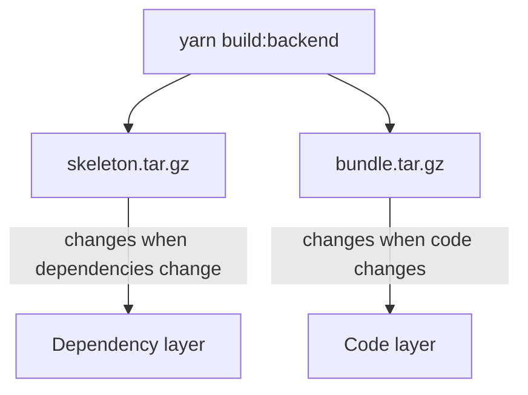

# The Skeleton And Bundle Archives

A Backstage backend needs its compiled code and its production dependencies inside the image. The two things change at different speeds: dependencies change rarely and code changes all day. The backend build therefore writes two archives so that a Dockerfile can handle them in two separate steps. This part explains both archives, the command that makes them and the Dockerfile steps that use them.

## What yarn build:backend writes

The command `yarn build:backend` runs in the root of the repository. In a project made with the Backstage create-app tool, the root `package.json` defines it as a call to `backstage-cli package build` for the backend package. It compiles the backend and its local packages, and it writes into `packages/backend/dist` the following files:

- `skeleton.tar.gz` contains the `package.json` file of the backend and of every workspace package that the backend depends on, and nothing else.
- `bundle.tar.gz` contains the compiled code of the backend and of those packages, with their `package.json` files.

The skeleton has the shape of the workspace without any code. Yarn can read it to resolve and install the dependencies. The bundle has the code that runs.



The diagram shows the reason for the split. The skeleton lets Docker build the dependency layer from a file that changes rarely, so the slow install step is reused from the cache when only code changed.

## The Dockerfile steps in order

The standard host-build Dockerfile of a Backstage project uses the archives in this order. First it copies `yarn.lock`, the root `package.json` and `skeleton.tar.gz` into the image and unpacks the skeleton. Then it installs the production dependencies of the workspaces. In Yarn 4, the command is `yarn workspaces focus --all --production`. Then it copies `bundle.tar.gz` and the configuration files and unpacks the bundle. Last it sets the start command.

The order matters because of the Docker layer cache. The step that installs dependencies depends only on the files copied before it: the lockfile and the skeleton. A change in a source file changes the bundle but not the skeleton, so the install step and every step before it stay cached.

## The install step needs the lockfile

The command `yarn install --immutable` and the focus command read `yarn.lock`. The lockfile pins the exact version of each dependency, so two builds of the same revision install the same packages. If the Dockerfile skips the lockfile, the install resolves versions again and two builds of the same commit can differ.

Native modules are a second concern. Some dependencies, for example database drivers, compile C or C++ code during installation. That needs a compiler and Python in the image at install time. The Backstage Dockerfile installs `python3`, `g++` and `build-essential` for this reason, in the same stage that runs the install.

## Where the archives come from

In a host build, the archives exist before Docker starts. The pipeline runs `yarn install --immutable`, `yarn tsc` and `yarn build:backend` first. The Dockerfile cannot tell whether the archives belong to the current commit. In a multi-stage build, an earlier stage runs the same commands inside Docker, so the archives always belong to the context that Docker received.

<!-- astrona:playground:renew -->

The playground workspace has a simplified build script. It plays the role of `yarn build:backend`, but it writes only `bundle.tar.gz`, because the stand-in has no registry dependencies. Build it and list the archive:

```sh
cd /opt/portal
npm run build:backend
ls -l packages/backend/dist
tar -tzf packages/backend/dist/bundle.tar.gz
```

The archive lists the backend `package.json`, the entry file and a build identifier file. Now unpack the archive into a temporary folder to see the layout that the image will receive:

```sh
mkdir /tmp/inspect && tar -xzf packages/backend/dist/bundle.tar.gz -C /tmp/inspect
find /tmp/inspect -type f
rm -r /tmp/inspect
```

The files sit under `packages/backend`, which is why the image start command is `node packages/backend`. Read the Dockerfile that unpacks it:

```sh
cat packages/backend/Dockerfile
```

Notice that the `COPY` of the archive comes before the `COPY` of the configuration files, and that the unpack step deletes the archive in the same `RUN` instruction.

## What you know now

`yarn build:backend` writes a skeleton with only the package manifests and a bundle with the compiled code. The Dockerfile installs production dependencies from the skeleton and the lockfile, then unpacks the bundle on top. The split exists so that Docker can cache the slow dependency step. The open question is what exactly Docker caches and what invalidates it.

## Common pitfalls

> [!WARNING]
> Unpack and delete an archive in one `RUN` instruction. If the delete is a later instruction, the archive stays in an earlier layer and the image keeps its size.
