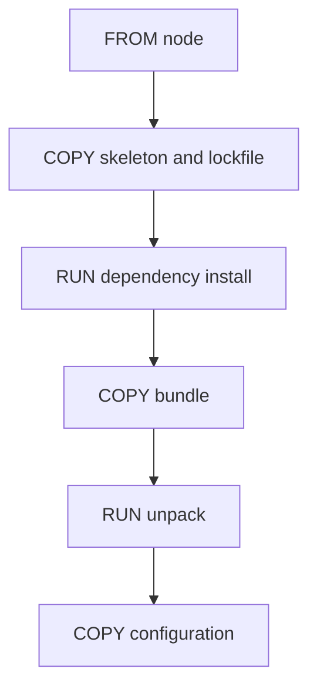

# Layers And The Build Cache

A build that takes four minutes after a one-line change wastes a developer's time and a pipeline's money. Docker avoids repeated work with a cache, but only when the Dockerfile is ordered so that the cache can be used. This part explains what a layer is, what makes Docker reuse it, and how to read the build output to see the cache work.

A **layer** is a stored set of file changes. Each instruction that changes the filesystem, such as `RUN`, `COPY` and `ADD`, produces a layer. Instructions such as `ENV`, `USER` and `CMD` change only metadata. The image is the ordered stack of layers plus that metadata.

## The cache rule

Docker checks each instruction from the top. For an instruction it asks if it has already built a layer from the same parent layer with the same instruction. For `RUN`, the instruction text must match. For `COPY` and `ADD`, Docker also compares the content of the copied files. If the answer is yes, Docker reuses the layer and marks the step as cached. If the answer is no, Docker runs the step. Once one step runs, every later step runs too, because their parent layer is new.

This rule explains the ordering advice. Put the steps that change rarely first and the steps that change often last. In a Backstage Dockerfile, the lockfile and skeleton come before the dependency install, and the bundle and configuration come after it. A change in application code leaves the top of the file untouched, so only the last layers are rebuilt.



The diagram shows one build order. A change in the bundle invalidates the layer for the bundle copy and every layer below it. The three layers above it stay cached.

## Reading the build output

BuildKit prints one block per step. With the option `--progress=plain`, every step is shown in full and a cached step is marked with the word `CACHED`. The older builder prints `Using cache` after the step. The first build of a Dockerfile runs every step. A second identical build shows every step as cached and finishes in a moment.

Two other commands help. `docker image history <image>` lists the layers of an image with the instruction and size of each one. The option `--no-cache` on `docker image build` ignores the cache and runs every step, which is the right choice when a step downloads something that must be fresh.

## What invalidates more than you expect

Copying the whole context with `COPY . .` makes the cache depend on every file. Any changed file, even a note in a documentation folder, changes the copied content and invalidates that layer and all later layers. Naming the files that the image needs keeps the cache stable. The same applies to a build argument or an environment variable that changes on every build, such as a timestamp: the step that uses it always runs.

The cache lives on the machine that built it. A new continuous integration runner starts with an empty cache. Pipelines therefore export and import the cache, for example with the BuildKit options `--cache-to` and `--cache-from`, so that a fresh runner can reuse layers.

<!-- astrona:playground:renew -->

Build the host-build image twice and compare the output. Make sure the bundle exists first:

```sh
cd /opt/portal
npm run build:backend
docker image build . -f packages/backend/Dockerfile --tag portal:cache --progress=plain 2>&1 | tail -n 25
docker image build . -f packages/backend/Dockerfile --tag portal:cache --progress=plain 2>&1 | grep -E "CACHED|Using cache"
```

The second build marks the steps as cached. Now change the source revision, rebuild the bundle, and build again:

```sh
echo r3 > packages/backend/src/build-id
npm run build:backend
docker image build . -f packages/backend/Dockerfile --tag portal:cache --progress=plain 2>&1 | grep -E "CACHED|Using cache|RUN|COPY"
```

The steps before the bundle copy are cached, and the bundle copy and the steps after it run again. Look at the layers and their sizes:

```sh
docker image history portal:cache
```

Finally, create an unrelated file and see that it does not matter, because the Dockerfile copies named files:

```sh
echo "notes" > notes.txt
docker image build . -f packages/backend/Dockerfile --tag portal:cache --progress=plain 2>&1 | grep -E "CACHED|Using cache"
```

The steps stay cached. Delete `notes.txt` afterwards.

## What you know now

Each filesystem instruction creates a layer. Docker reuses a layer when the instruction and its input files match a previous build, and one rebuilt step forces every later step to rebuild. Ordering the Dockerfile from rarely changed to often changed input, and copying named files instead of the whole context, keeps the cache useful. The open question is how to speed up the steps that must still run, such as package downloads.

## Common pitfalls

> [!WARNING]
> `COPY . .` before the dependency install makes every file change rebuild the dependencies. Copy the manifest files first, install, and copy the rest after.
