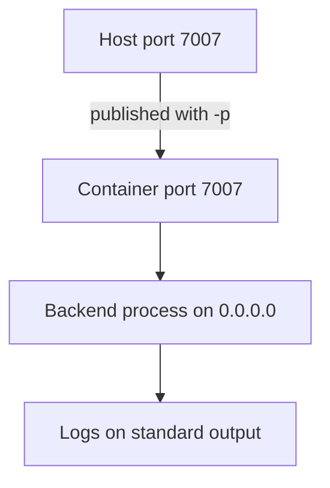

# Running And Inspecting A Container

A finished image does nothing until someone starts a container from it. Many deployment problems appear at this step even though the build was correct: a port that no one can reach, a process that exits at once, a container that cannot find its configuration. This part explains how a container starts, how the port is published, and which commands show what is happening.

A **container** is a running instance of an image. Docker starts the command stored in the image, in an isolated process space with its own filesystem and network. The command `docker run` creates and starts a container in one step.

## Publishing a port

A container has its own network. A process that listens on port 7007 inside the container is not reachable from the host until the port is published. The option `-p 7007:7007` maps host port 7007 to container port 7007. The left number is the host side and the right number is the container side. The mapping `-p 8080:7007` makes the backend answer on host port 8080.

The address that the process binds inside the container matters too. A backend that listens on `127.0.0.1` accepts only connections from inside its own container, so a published port cannot reach it. The process must bind `0.0.0.0`. In a Backstage project, `backend.listen.host` in the production configuration does this, and the start command must load that file.

```sh
docker run -d --name portal -p 7007:7007 backstage
```

The option `-d` runs the container in the background and `--name` gives it a name that later commands can use. Without `-d`, the command stays attached and prints the log of the process.

## Looking at a running container

Four commands answer most questions. `docker container ls` lists running containers with their ports. `docker logs portal` prints what the process wrote to standard output and standard error, and the option `-f` follows new lines. `docker exec -it portal sh` starts a shell inside the container. `docker inspect portal` prints the full configuration as JSON, and the option `--format` selects one field.

A container that exits at once shows up only in `docker container ls -a`. The exit code and the last log lines usually name the cause. Exit code 1 normally means the process stopped with an error, and the log shows the message.



The diagram shows the path of a request. A request that stops before the process fails for a network reason. A process that never starts has a log entry that says why.

## Stopping and removing

`docker stop portal` sends the process a termination signal and waits ten seconds before it kills it. `docker rm portal` removes the stopped container, and `docker rm -f portal` stops and removes in one step. The option `--rm` on `docker run` removes the container automatically when it exits, which suits one-off checks. Removing a container does not remove the image.

A Node.js process that runs as the main process of a container receives the termination signal directly, so it can shut down cleanly when the application handles it. A shell script that starts Node.js as a child can swallow the signal, and the container is then killed after the timeout. The Backstage Dockerfile avoids this by using the exec form of `CMD`, a JSON array, which starts Node.js without a shell.

<!-- astrona:playground:renew -->

The playground has an image named `portal:run` and a workspace in `/opt/portal`. Start a container and look at it:

```sh
docker run -d --name portal -p 7007:7007 portal:run
docker container ls
docker logs portal
curl http://127.0.0.1:7007/healthcheck
```

The log shows the host and port that the backend bound, and the request returns a small JSON body with `status` set to `ok`. Run a command inside the container and read one field of its configuration:

```sh
docker exec portal id
docker inspect --format '{{.NetworkSettings.Ports}}' portal
docker inspect --format '{{.Config.Cmd}}' portal
```

The first command prints the user and group ids of the process. The second shows the port mapping, and the third shows the start command with its two `--config` options. Now cause a failure. Start a second container with a different start command that names a missing file:

```sh
docker run --name broken portal:run node packages/backend --config missing.yaml
docker container ls -a
docker logs broken
```

The container exited. The log names the file that the backend could not read. Remove both containers:

```sh
docker rm -f portal broken
```

## What you know now

A container is an image plus a running process. A port is reachable from the host only when it is published and when the process binds `0.0.0.0`. The commands `logs`, `exec` and `inspect` show the process output, the container internals and the stored settings, and a container that exited still keeps its log until it is removed. The next question is how to change the configuration without building a new image.

## Common pitfalls

> [!WARNING]
> A published port does not help if the process listens on `127.0.0.1` inside the container. Check the bind address in the log before you debug the network.
