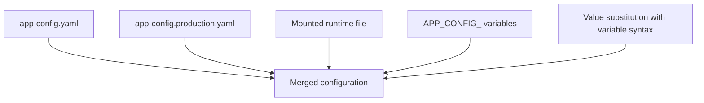

# Configuration At Run Time

The same image should run in a test environment and in production. Only the configuration changes: URLs, database hosts, credentials. If each environment needs its own image, the team tests one artifact and ships another. This part explains the three ways a Backstage container receives configuration at run time and the order in which they apply.

## Configuration files with --config

Backstage reads YAML files named with `--config` options on the start command. Each option names one file, and a later file overrides the same keys of an earlier one. The image holds `app-config.yaml` and `app-config.production.yaml`. An environment can add a third file that the image does not contain. The file is made available with a bind mount, which maps a file or folder of the host into the container:

```sh
docker run -d --name portal -p 7007:7007 \
  -v "$(pwd)/runtime/app-config.runtime.yaml:/config/app-config.runtime.yaml:ro" \
  backstage \
  node packages/backend --config app-config.yaml --config app-config.production.yaml --config /config/app-config.runtime.yaml
```

The suffix `:ro` mounts the file read-only, so the process cannot change it. Everything after the image name replaces the `CMD` of the image, so the command must repeat the two files from the image and add the new one. A path in the mount that does not exist on the host makes Docker create an empty directory in its place, which leads to an error that the configuration is a directory and not a file.

## Environment variables inside configuration files

A configuration value can read an environment variable. The syntax `${NAME}` in a value is replaced with the variable when the configuration loads. The Backstage database settings use it:

```yaml
backend:
  database:
    client: pg
    connection:
      host: ${POSTGRES_HOST}
      port: ${POSTGRES_PORT}
      user: ${POSTGRES_USER}
      password: ${POSTGRES_PASSWORD}
```

The file is committed and contains no secret. The container receives the values with `-e POSTGRES_HOST=db` or with `--env-file`, which reads `NAME=value` lines from a file. A variable that is missing makes the configuration load fail with an error that names it.

## APP_CONFIG_ variables

Backstage also reads environment variables whose names start with `APP_CONFIG_`. The rest of the name is a path in the configuration, with an underscore between levels. The value is parsed as JSON when it can be, and kept as a string otherwise. For example `APP_CONFIG_backend_listen_port=7008` sets `backend.listen.port` to the number 7008, and `APP_CONFIG_app_title='"My Portal"'` sets a string. These variables apply after the files, so they override values from all of them.



The diagram shows the sources. Files merge in order, `${NAME}` references inside them read the environment, and `APP_CONFIG_` variables apply last.

## Which configuration reaches the browser

The frontend configuration is public. A key reaches the browser only when the plugin that declares its schema marks it with the visibility `frontend`. A value that is not marked stays on the server. The container does not change this rule, but it changes where the secret is stored. A token in a mounted file or an environment variable is available to the backend only. The same token in an image layer is available to everyone who can pull the image.

<!-- astrona:playground:renew -->

The stand-in backend in the playground reads `--config` files and answers `GET /config` with the files it loaded and the port it chose. It does not read `${NAME}` or `APP_CONFIG_` variables, so those two are explained here but not run. Look at the runtime file and start a container that mounts it:

```sh
cd /opt/portal
cat runtime/app-config.runtime.yaml
docker run -d --name portal -p 7007:7100 \
  -v "$(pwd)/runtime/app-config.runtime.yaml:/config/app-config.runtime.yaml:ro" \
  portal:run \
  node packages/backend --config app-config.yaml --config app-config.production.yaml --config /config/app-config.runtime.yaml
curl http://127.0.0.1:7007/config
```

The runtime file sets port 7100, so the process listens on 7100 inside the container and the mapping `7007:7100` publishes it on host port 7007. The response lists all three files. Now try to write to the mounted file from inside the container:

```sh
docker exec portal sh -c 'echo x >> /config/app-config.runtime.yaml'
```

Docker reports that the filesystem is read-only. Pass a token with an environment file and check that the process sees it but the image does not:

```sh
docker rm -f portal
docker run -d --name portal -p 7007:7007 --env-file runtime/portal.env portal:run
curl http://127.0.0.1:7007/status
docker image inspect --format '{{.Config.Env}}' portal:run
docker rm -f portal
```

The status shows `tokenConfigured` set to `true`, and the image environment does not contain the token.

## What you know now

A container receives configuration in four layers: the files in the image, extra files from mounts, `${NAME}` references that read the environment, and `APP_CONFIG_` variables that apply last. The mounted file and the variables stay outside the image, so one image serves every environment. The remaining question is what the process is allowed to do once it runs.

## Common pitfalls

> [!WARNING]
> A command after the image name replaces the whole `CMD`. Repeat every `--config` option you still need, or the container starts without them.
