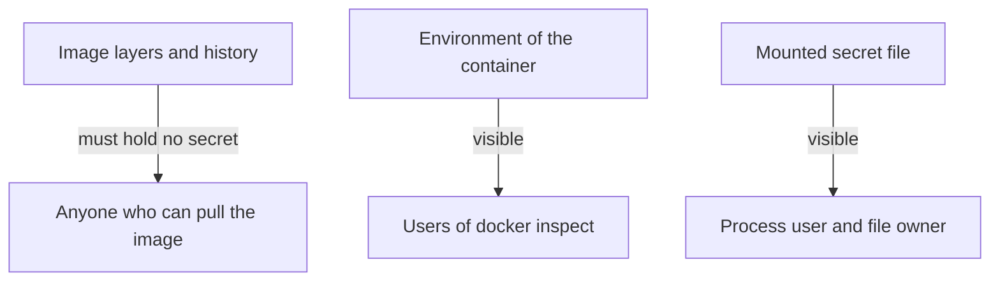

# Identity, Privileges And Secrets

A Backstage backend holds credentials for source control, the catalog database and identity providers. If an attacker finds a flaw in the backend, the container settings decide how much that attacker can do next. This part explains the settings that reduce the damage and the places where a secret is visible even when it was kept out of the image.

## The user inside the container

A process in a container runs as the user named in the image. If the image names none, the user is `root`, with user id 0. Root inside a container is limited by the isolation of the container, but a flaw in the isolation gives it a strong position on the host. The official `node` image contains an unprivileged user named `node` with id 1000. The Backstage Dockerfile switches to it with `USER node`, after it creates the working directory and gives it to that user.

The option `--user 1000:1000` on `docker run` overrides the user of the image. A platform can also refuse to start containers whose user is root. A volume mounted into the container keeps the ownership of the host files, so the user in the container needs read permission on them.

## Reducing what the process can do

Four options narrow the container further:

- `--read-only` makes the root filesystem read-only. A process that needs to write, for example to a temporary directory, gets a writable area with `--tmpfs /tmp`.
- `--cap-drop ALL` removes all Linux capabilities. A capability is a single privilege that root has, such as binding a port below 1024 or changing file ownership. A Node.js backend on port 7007 needs none of them.
- `--security-opt no-new-privileges` stops a process from gaining privileges through set-user-id programs.
- `--memory 1g` and `--cpus 1` limit the resources, so one container cannot use the whole host.

```sh
docker run -d --name portal -p 7007:7007 \
  --read-only --tmpfs /tmp \
  --cap-drop ALL --security-opt no-new-privileges \
  --memory 1g \
  backstage
```

These settings are not part of the image. They belong to the run command or to the platform that starts the container, for example the security context of a Kubernetes pod. A hardened image can still be started without them.

## Where a secret is visible

A secret kept out of the image is still visible in some places. `docker inspect` prints the environment of a container, so anyone who can run Docker commands on the host can read `-e` values. The process environment is also readable in `/proc` by the same user. A file mounted from the host is readable by the process and by the host user who owns it.

A secret that has to stay out of Docker metadata is passed as a mounted file that only the container user can read, and the application reads the path. In an orchestrator, the platform secret store injects the value. The rule that does not change is that the image holds no credential. A scan of the image layers and of `docker image history` must find none.



The diagram shows who can read each location. The image is the widest audience, so it must hold nothing secret.

<!-- astrona:playground:renew -->

Start a hardened container and look at the stored settings:

```sh
cd /opt/portal
docker run -d --name portal -p 7007:7007 --read-only --tmpfs /tmp --cap-drop ALL --security-opt no-new-privileges --env-file runtime/portal.env portal:run
docker inspect --format 'user={{.Config.User}} readonly={{.HostConfig.ReadonlyRootfs}} caps={{.HostConfig.CapDrop}} opt={{.HostConfig.SecurityOpt}}' portal
curl http://127.0.0.1:7007/healthcheck
```

The container answers although it is restricted, so the backend needs no write access and no capability. Try to write inside the container:

```sh
docker exec portal sh -c 'touch /app/test-file'
docker exec portal sh -c 'touch /tmp/test-file && echo tmp-ok'
```

The first command fails because the filesystem is read-only. The second succeeds because of the `tmpfs` mount. Now see where the token is visible:

```sh
docker inspect --format '{{.Config.Env}}' portal
docker image history portal:run
docker rm -f portal
```

The container metadata shows the token, and the image history does not.

## What you know now

A container should run as an unprivileged user, with a read-only root filesystem, no capabilities and resource limits. These options belong to the run command or the platform, so an image alone does not enforce them. A secret that is not in the image is still readable through the environment of the container, so the choice of how to pass it depends on who can reach Docker on the host. The last part adds the database, the health check and the frontend.

## Common pitfalls

> [!WARNING]
> A read-only root filesystem makes a process fail if it writes a temporary file. Add `--tmpfs /tmp` and check the log before you remove the restriction.
