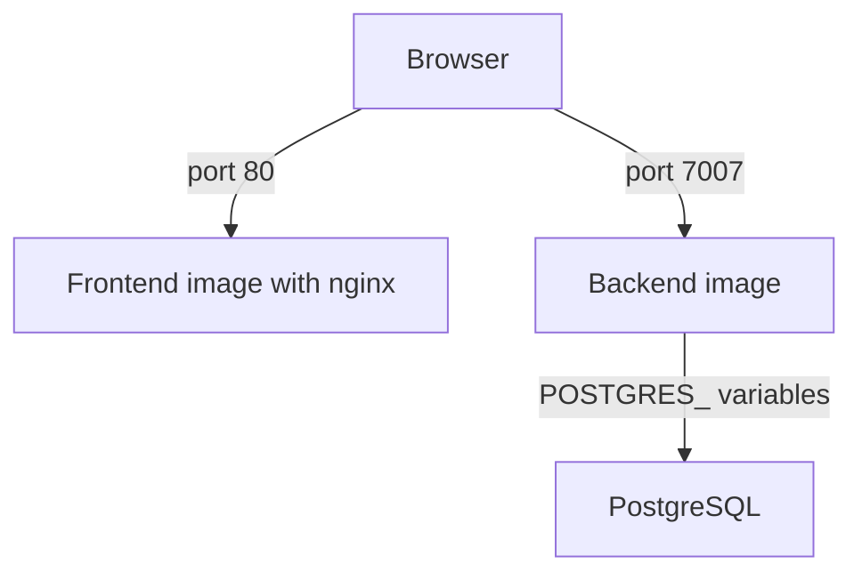

# Database, Health Checks And The Frontend Image

A backend container that starts is not yet a working portal. It needs a database that survives restarts, a way for the platform to know when it is ready, and a place to serve the frontend files. This part covers the PostgreSQL connection, container health checks and the separate frontend image that the Backstage documentation describes.

## PostgreSQL through environment variables

Without configuration, a Backstage backend uses an in-memory SQLite database. The data is gone when the process stops. For a real deployment, the configuration sets `backend.database.client` to `pg` and reads the connection from `${NAME}` references to variables: `POSTGRES_HOST`, `POSTGRES_PORT`, `POSTGRES_USER` and `POSTGRES_PASSWORD`. The `pg` driver is a dependency of the backend package, so the image contains it only when the dependency is declared there.

The database runs as a separate container or as a managed service. Containers on the same user-defined Docker network reach each other by container name. The commands below start a database and the backend on one network:

```sh
docker network create portal-net
docker run -d --name db --network portal-net -e POSTGRES_PASSWORD=change-me postgres:16-bookworm
docker run -d --name portal --network portal-net -p 7007:7007 \
  -e POSTGRES_HOST=db -e POSTGRES_PORT=5432 -e POSTGRES_USER=postgres -e POSTGRES_PASSWORD=change-me \
  backstage
```

The backend creates one database for each plugin, so the database user needs the right to create databases. A start where the database is not ready yet fails and the container exits. A restart policy such as `--restart unless-stopped` or a start order in the platform handles that.

## Health checks

A health check is a command that Docker runs inside the container at an interval. A container whose check fails repeatedly is marked `unhealthy`. Docker itself only reports the state, but orchestrators use it to restart a container or to hold back traffic. The check can be set in the Dockerfile with `HEALTHCHECK` or on the run command:

```sh
docker run -d --name portal -p 7007:7007 \
  --health-cmd "node -e \"require('http').get('http://127.0.0.1:7007/healthcheck',r=>process.exit(r.statusCode===200?0:1)).on('error',()=>process.exit(1))\"" \
  --health-interval 10s --health-timeout 3s --health-retries 3 \
  backstage
```

The slim Node.js image has no `curl`, so the command uses Node.js itself. The state is read with `docker inspect --format '{{.State.Health.Status}}'`, which is `starting`, `healthy` or `unhealthy`. In recent Backstage versions the backend exposes the endpoints `/.backstage/health/v1/readiness` and `/.backstage/health/v1/liveness`. Older projects use `/healthcheck`. A liveness check says that the process runs. A readiness check says that it can take traffic, for example that the database connection works. Use the endpoints that the installed version provides.

## The frontend image

The backend image can serve the compiled frontend when the project uses the app-backend plugin. The Backstage documentation also describes a separate frontend image. It builds the frontend with `yarn build:all` or the app build, copies `packages/app/dist` into an `nginx` image and serves it on port 80. A small nginx configuration sends unknown paths to `index.html`, so client-side routes work.

The frontend image has no secrets, because the browser downloads everything in it. The `app.baseUrl` and `backend.baseUrl` values are compiled into the files or injected at start, and they must be the public URLs. The backend then needs `app.baseUrl` and the CORS origin to match the address that users open, or the browser blocks the requests.



The diagram shows three separate deployments. Each one scales and updates on its own.

<!-- astrona:playground:renew -->

The stand-in backend does not use a database, so run PostgreSQL alone and check its readiness with the tool in the image:

```sh
docker network create portal-net
docker run -d --name db --network portal-net -e POSTGRES_PASSWORD=change-me postgres:16-bookworm
docker exec db pg_isready -U postgres
```

The command prints whether the server accepts connections, and it may report that it does not while the database starts. Run it again after a few seconds. Now start the backend with a health check and read its state:

```sh
cd /opt/portal
docker run -d --name portal --network portal-net -p 7007:7007 \
  --health-cmd "node -e \"require('http').get('http://127.0.0.1:7007/healthcheck',r=>process.exit(r.statusCode===200?0:1)).on('error',()=>process.exit(1))\"" \
  --health-interval 5s --health-retries 3 portal:run
sleep 12
docker inspect --format '{{.State.Health.Status}}' portal
```

The status is `healthy`. Stop the container and list it:

```sh
docker stop portal
docker container ls -a --filter name=portal
```

The container shows as exited, because the backend was its main process. Clean up:

```sh
docker rm -f portal db
docker network rm portal-net
```

## What you know now

The backend keeps data in PostgreSQL when `backend.database` is configured and the connection values come from environment variables. A health check lets Docker and platforms see whether the process answers, and readiness and liveness answer different questions. The frontend can ship in the backend image or in a separate nginx image, and it never holds secrets. A deployment is complete only when all of these parts run together, which a successful build alone does not show.

## Common pitfalls

> [!WARNING]
> A health check that runs `curl` fails in an image without `curl`, and the container shows as unhealthy although the backend works. Test the check command with `docker exec` first.
